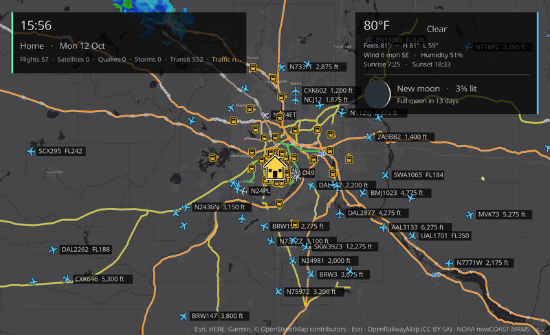
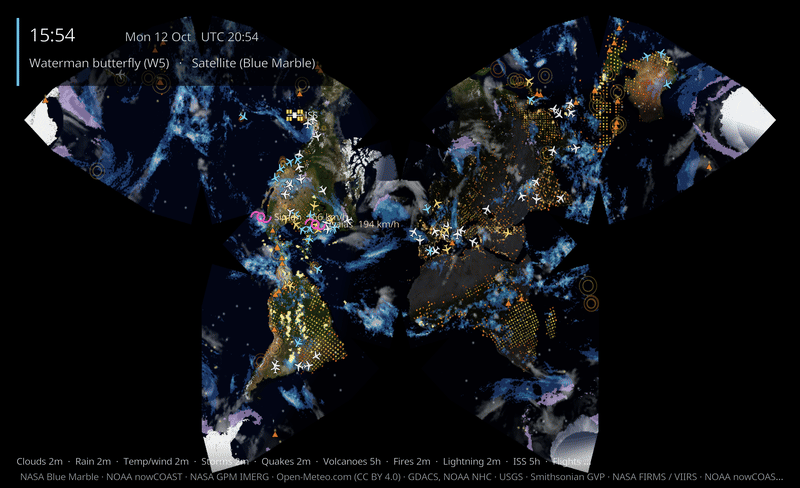
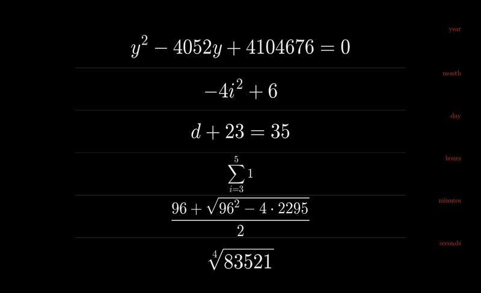
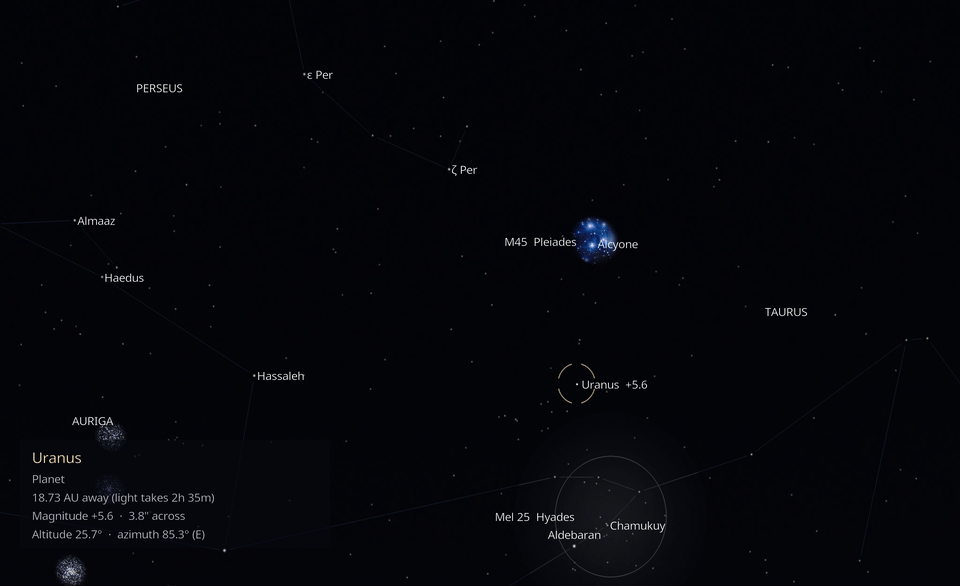
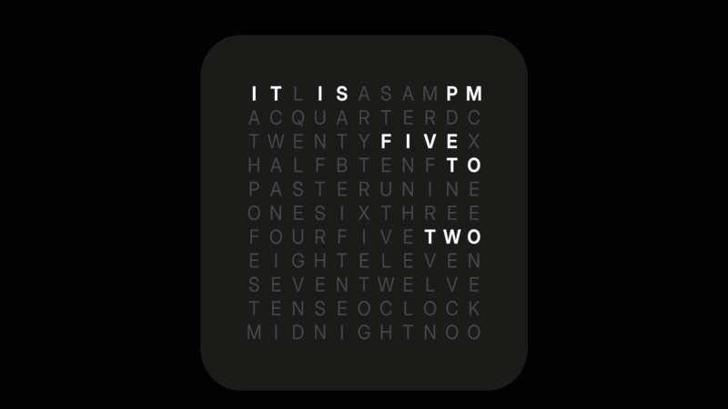
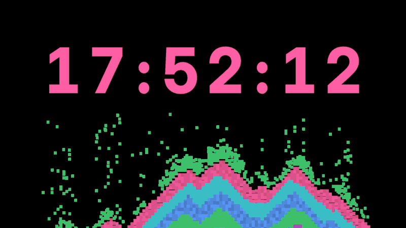
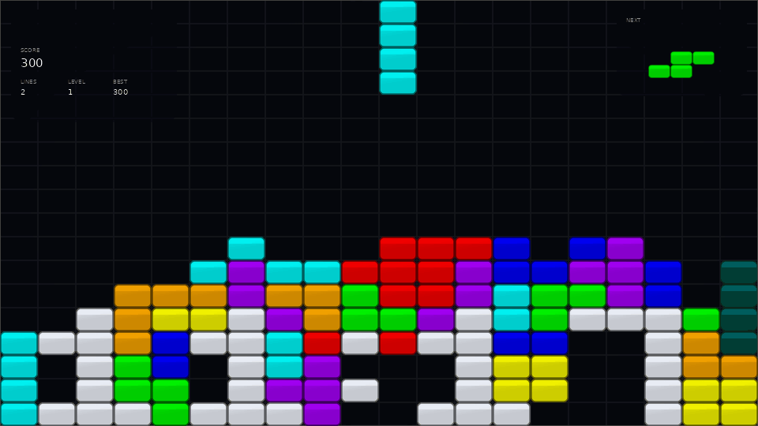
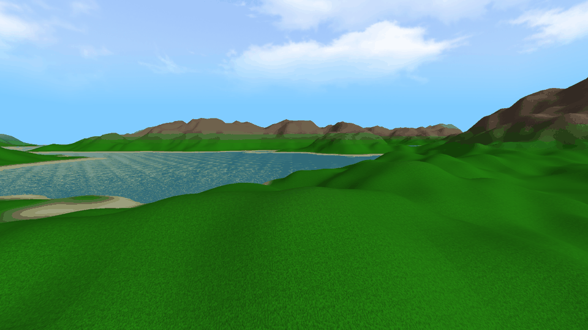
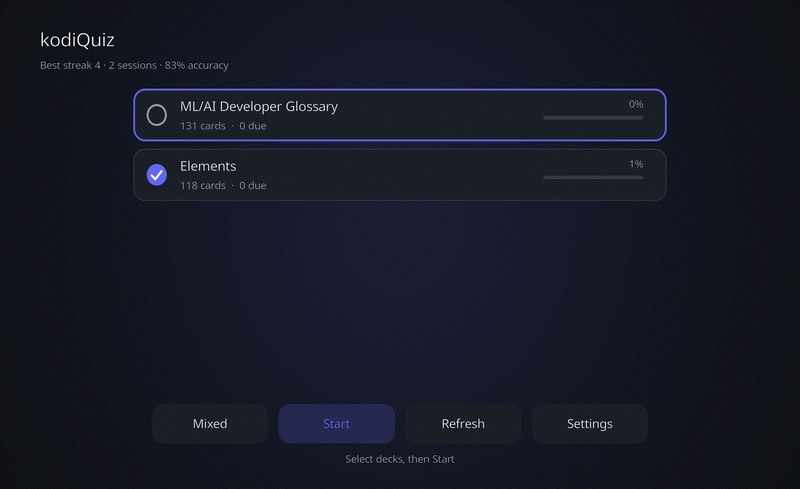
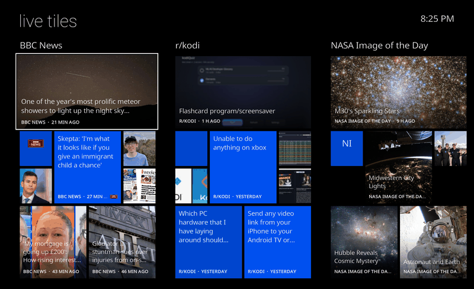

# P-Hoep Kodi Add-ons

Ambient screensavers, a word clock, a sand clock, a Jeopardy! slideshow, a weather station, a
live-camera window, a scheduler, a flashcard app, a trivia quiz, a news reader, a music
visualisation and an audiobook player for Kodi, published as one Kodi repository so Kodi installs
them and keeps them up to date.

Most add-ons are pure Python and run on any Kodi 19 (Matrix) or later device. The OpenGL add-ons
are native, GPU-drawn add-ons built for macOS (Intel and Apple Silicon) and Android, with
separate 32-bit Android builds for Fire TV and Google TV boxes. They were developed and tested
on Kodi 21 (Omega) on macOS; many also on Fire TV Sticks and Android TV boxes.

- **[Deployment guide](docs/deployment.md)**: build, package, publish and install.
- **[Development guide](docs/development.md)**: develop the Python and OpenGL add-ons and test them.
- **[Fire TV notes](docs/fire-sticks.md)**: the sticks on the home network and how to deploy to them.

## Add-ons at a glance

Versions below are the ones in each add-on's `addon.xml`, which is authoritative. Kodi shows the
installed version in **Add-ons → My add-ons**.

### Screensavers — Python (Kodi 19+ unless noted)

| Add-on | Add-on id | Version | What it is |
|---|---|---|---|
| [God's Eye Map](#gods-eye-map) | `screensaver.godseye.map` | 0.2.2 | A live map of a place you choose: flights, satellites, weather, traffic and transit |
| [God's World Map](#gods-world-map) | `screensaver.godsworld.map` | 0.1.1 | The whole Earth in thirteen projections, with live weather and events |
| [Math Clock](#math-clock) | `screensaver.math.clock` | 0.1.1 | The date and time as maths puzzles, typeset like LaTeX |
| [Couchstronomy](#couchstronomy) | `screensaver.couchstronomy` | 0.1.3 | Your TV as a window onto the real night sky |
| [SkyWatch](#skywatch) | `screensaver.skywatch` | 1.0.0 | A live weather station: radar, forecasts, warnings and conditions |
| [Vintage Radar](#vintage-radar) | `screensaver.vintageradar` | 1.0.1 | A green-phosphor radar scope showing the aircraft flying over you right now (Kodi 20+) |
| [Live Cams](#live-cams) | `screensaver.livecams` | 1.0.0 | A window onto public live cameras around the world |
| [GeoGuess](#geoguess) | `screensaver.geoguess` | 0.2.0 | A random street-view panorama, named a few seconds later |
| [Word Clock](#word-clock) | `screensaver.wordclock` | 1.0.0 | The time in words on a grid of letters, with your own fonts and colours |
| [Sand Clock](#sand-clock) | `screensaver.sandclock` | 1.0.1 | A clock whose digits crumble into falling sand every second |
| [Jeopkodi](#jeopkodi) | `screensaver.jeopkodi` | 1.1.0 | An endless Jeopardy! slideshow: clue, then the response |
| [OpenTrivia](#opentrivia) | `screensaver.opentrivia` | 1.0.0 | A trivia question, a countdown, then the answer |
| [DVD Logo](#dvd-logo) | `screensaver.dvdlogo` | 1.0.1 | The classic bouncing DVD logo, with corner tricks |
| [Tetris AI](#tetris-ai) | `screensaver.tetris` | 1.1.1 | An AI plays Tetris edge to edge, with a clock made of blocks |
| [Sheetcards Screensaver](#sheetcards) | `screensaver.sheetcards` | 1.0.0 | Flashcards from a Google Sheet (Kodi 20+) |
| [RSS Live Tiles Screensaver](#rss-live-tiles) | `screensaver.rsslivetiles` | 1.0.0 | Your RSS and Atom feeds as Windows Phone style live tiles (Kodi 20+) |

### Native screensavers — OpenGL / OpenGL ES (Kodi 21)

| Add-on | Add-on id | Version | Platforms |
|---|---|---|---|
| [Tetris AI (OpenGL)](#tetris-ai-opengl) | `screensaver.tetris.gl` | 1.0.2 | macOS, Android 64-bit |
| [Tetris AI (OpenGL, 32-bit Android)](#tetris-ai-opengl) | `screensaver.tetris.gl.armv7` | 1.0.2 | Android 32-bit |
| [Endless World (OpenGL)](#endless-world-opengl) | `screensaver.infworld.gl` | 1.0.1 | macOS, Android 64-bit |
| [Endless World (OpenGL, 32-bit Android)](#endless-world-opengl) | `screensaver.infworld.gl.armv7` | 1.0.1 | Android 32-bit |
| [Growing Plant (OpenGL)](#growing-plant-opengl) | `screensaver.plant.gl` | 1.0.1 | macOS, Android 64-bit |
| [Growing Plant (OpenGL, 32-bit Android)](#growing-plant-opengl) | `screensaver.plant.gl.armv7` | 1.0.1 | Android 32-bit |
| [Sand Clock (OpenGL)](#sand-clock-opengl) | `screensaver.sandclock.gl` | 1.0.0 | macOS, Android 64-bit |
| [Sand Clock (OpenGL, 32-bit Android)](#sand-clock-opengl) | `screensaver.sandclock.gl.armv7` | 1.0.0 | Android 32-bit |
| [Cellular Automata (32-bit Android)](#cellular-automata) | `screensaver.automata.armv7` | 1.1.0 | Android 32-bit |
| [Cellular Automata Lite (32-bit Android)](#cellular-automata) | `screensaver.automata.lite.armv7` | 1.1.0 | Android 32-bit |
| [Cellular Automata 3D (32-bit Android)](#cellular-automata-3d) | `screensaver.automata3d.armv7` | 1.0.0 | Android 32-bit |
| [Liquid Clock (32-bit Android)](#liquid-clock) | `screensaver.liquidclock.armv7` | 1.1.0 | Android 32-bit |
| [Physarum (32-bit Android)](#physarum) | `screensaver.physarum.armv7` | 1.0.0 | Android 32-bit |
| [Physarum Lite (32-bit Android)](#physarum-lite) | `screensaver.physarum.lite.armv7` | 1.3.0 | Android 32-bit |

### Apps, services and visualisation

| Add-on | Add-on id | Version | What it is |
|---|---|---|---|
| [Screensaver Switcher](#screensaver-switcher) | `service.screensaver.switcher` | 0.1.0 | Different screensavers at different times of day (Kodi 19+) |
| [Audioshelf](#audioshelf) | `plugin.audio.audioshelf` | 1.1.0 | Audiobooks from an Audiobookshelf server (Kodi 19+) |
| [Sheetcards](#sheetcards) | `script.sheetcards` | 1.0.0 | The flashcard study app (Kodi 20+) |
| [RSS Live Tiles](#rss-live-tiles) | `script.rsslivetiles` | 1.0.0 | The live-tile news reader (Kodi 20+) |
| [OpenTrivia](#opentrivia) | `script.opentrivia` | 1.0.0 | The trivia quiz you play with the remote (Kodi 20+) |
| [Vintage Radar](#vintage-radar) | `script.vintageradar` | 1.0.2 | The Vintage Radar scope in a driveable window (Kodi 20+) |
| [Physarum Visualisation (macOS and 64-bit Android)](#physarum-visualisation) | `visualization.physarum.lite` | 1.0.0 | Physarum driven by Kodi's audio (Kodi 21) |
| Physarum Visualisation (32-bit Android) | `visualization.physarum.lite.armv7` | 1.0.0 | The same visualisation for 32-bit Android Kodi |

### Library modules and repository

| Add-on | Add-on id | Version | What it is |
|---|---|---|---|
| Sheetcards library | `script.module.sheetcards` | 1.0.0 | Shared code for the Sheetcards app and screensaver |
| RSS Live Tiles library | `script.module.rsslivetiles` | 1.0.0 | Shared code for the RSS Live Tiles app and screensaver |
| OpenTrivia library | `script.module.opentrivia` | 1.0.0 | The questions database, shared window and skin for the OpenTrivia add-ons |
| Vintage Radar library | `script.module.vintageradar` | 1.0.1 | The scope's model, feeds, window, text renderer and textures, shared by the Vintage Radar app and screensaver |
| P-Hoep Add-ons | `repository.phoep` | 1.0.11 | The Kodi repository that installs and updates everything |

The library modules are installed automatically as dependencies; there is nothing to configure.

## Requirements

| Add-ons | Kodi | Notes |
|---|---|---|
| Most Python add-ons | 19 (Matrix) or later | Pure Python, no compiled code; any platform |
| Sheetcards, RSS Live Tiles, OpenTrivia, Vintage Radar and their modules | 20 (Nexus) or later | They require `xbmc.python` 3.0.1 |
| Native OpenGL add-ons | 21 (Omega) | Compiled against the Kodi 21 add-on API |

The Python add-ons need no imaging library at run time: all artwork is generated ahead of time and
shipped in the add-on. Some add-ons use `script.module.certifi` (and RSS Live Tiles also
`script.module.pyqrcode`), which Kodi installs from its official repository by itself.

### Which native build do I need?

| Device | Install |
|---|---|
| macOS, Intel or Apple Silicon | the base add-on (universal `.dylib`) |
| 64-bit Android Kodi (for example Nvidia Shield, many recent Android TV boxes) | the base add-on (arm64-v8a `.so`) |
| 32-bit Android Kodi: Fire TV, many Google TV boxes, Chromecast with Google TV | the **32-bit Android** add-on (armeabi-v7a `.so`) |

A 64-bit library cannot load in 32-bit Kodi, and vice versa. That is why the 32-bit builds are
separate add-ons with their own ids and names rather than a second file in the same zip.

## Install from the repository

All the add-ons are published as a Kodi repository at **https://p-hoep.github.io/kodi/**, so Kodi
installs them and updates them itself.

1. **Settings → System → Add-ons → Unknown sources → On.**
2. **Settings → File manager → Add source →** enter `https://p-hoep.github.io/kodi/` and name it
   `phoep`.
3. **Settings → Add-ons → Install from zip file → phoep →**
   `repository.phoep-1.0.11.zip`.
4. **Settings → Add-ons → Install from repository → P-Hoep Add-ons.**
   - Screensavers are under **Look and feel → Screensaver**.
   - The Switcher is under **Services**.
   - Sheetcards, RSS Live Tiles, OpenTrivia and Vintage Radar are under **Program add-ons**.
   - Audioshelf is under **Music add-ons**.
   - Physarum Visualisation is under **Music → Visualisation** (inside Kodi's player settings, or
     from the music OSD while a song plays).
5. To turn a screensaver on, go to **Settings → Interface → Screensaver → Screensaver mode**,
   pick it, then open **Settings** below it to configure it. **Preview** starts it straight away.

Kodi checks the repository for new versions and updates installed add-ons automatically. To check
now, open **Add-ons → My add-ons**, open the add-on and choose **Update**.

## Updates and version numbers

Bump `version="…"` in an add-on's `addon.xml` and push to `main`. The
[Kodi repository workflow](.github/workflows/kodi-repo.yml) rebuilds the repository and deploys it
to GitHub Pages; installed copies update on Kodi's next repository check. Without a version bump
Kodi sees no update. Any new top-level folder with an `addon.xml` is picked up automatically.

The full procedure — local builds, the repository index, native libraries, Fire TV sideloading and
troubleshooting — is in the **[deployment guide](docs/deployment.md)**.

---

## God's Eye Map



A Kodi screensaver that shows a live map of a place you choose, with layers inspired by
[Bilawal Sidhu's God's Eye View](https://github.com/bilawalsidhu/gods-eye-view): flights, military
aircraft, satellites overhead, earthquakes, tropical storms, rain radar, infrared clouds,
lightning, rail/subway lines, live transit vehicles and traffic, plus a local weather card with
the moon phase and optional sensor looks (night vision, FLIR, CRT…).

Pure Python, no compiled dependencies. Tested on Kodi 21.1 (macOS) and 21.2 / 21.3 (Fire TV
Stick).

| Category | Settings |
|---|---|
| Location | Place name, **Find a place by name…** (searches and fills in the coordinates), latitude, longitude, zoom, home icon, base map (OpenStreetMap, Dark, Satellite, Satellite + labels, NASA satellite image of the day) |
| Air & space | Flights, military aircraft, flight refresh, satellites overhead and which group (space stations, 100 brightest, GPS, weather, Starlink) |
| Weather & Earth | Rain radar (US), infrared clouds (zoom ≤ 10), lightning (Americas), overlay opacity, earthquakes (period, minimum magnitude), tropical storms |
| Traffic & transit | TomTom API key, traffic flow, traffic incidents, traffic refresh, rail/subway/tram lines, live transit vehicles, extra GTFS-realtime URL |
| Weather card | Local weather (Open-Meteo), moon phase, °F/°C |
| Display | Sensor look, info card (place, clock, counts), marker labels, marker limit, dimming, slow drift for OLED/plasma screens |

Defaults: home (44.9031, -93.3096) at zoom 16. Zoom guide: 3 ≈ a continent, 9 ≈ a metro area,
13 ≈ streets, 16 ≈ a few blocks. Flights show from zoom 4, transit vehicles from zoom 8, rail
lines from zoom 7.

Layer notes:

- **Traffic** uses TomTom and needs a free TomTom API key, entered in the "TomTom API key"
  setting (nothing is built in). The free tier is 200,000 tiles/month; the default 10-minute
  refresh uses a few thousand a day.
- **Live transit vehicles** come from the keyless GTFS-realtime feeds God's Eye View uses:
  Boston (MBTA), Austin (CapMetro), Minneapolis–St Paul, Helsinki (HSL), the Netherlands
  (OVapi), Norway (Entur) and South East Queensland (TransLink). For another city, paste its
  GTFS-realtime *vehicle positions* URL into "Extra GTFS-realtime vehicle positions URL" (it
  must not need a key).
- **Rail, subway & tram lines** (OpenRailwayMap) work worldwide.
- **Rain radar and lightning** cover the US / the Americas only (NOAA). Infrared clouds are
  global but only drawn at zoom 10 and further out.
- **Satellites** are computed on the device from CelesTrak orbital elements (refreshed every
  6 hours) with the bundled `sgp4` library.

Data from adsb.lol, OpenSky Network, CelesTrak, USGS, NOAA, NASA GIBS, OpenRailwayMap, transit
agencies and TomTom. Map tiles © OpenStreetMap contributors, CARTO and Esri.

```bash
python3 tools/build_zip.py screensaver.godseye.map
KODI_ADDON=screensaver.godseye.map python3 tools/kodi.py install   # then select / run / shot
python3 -m unittest tests.test_core
```

Full documentation: **[docs/godseye-screensaver.md](docs/godseye-screensaver.md)**.

## God's World Map



The whole Earth as an ambient world map, in thirteen projections:

- **Classics:** Mercator, Robinson, Winkel tripel, Equal Earth, Gall–Peters and cylindrical
  equal-area.
- **Interrupted maps:** Goode homolosine and Sinu-Mollweide.
- **Unusual ones:** Fuller's Dymaxion, Peirce's quincuncial square, an octahedral butterfly,
  Waterman's butterfly on his W5 polyhedron, and a spinning globe.

Each projection can use a satellite, relief, OpenStreetMap or atlas base map, or be drawn as
**Dwarf Fortress-style ASCII art**, either from geography or from satellite imagery. Layers
include infrared clouds, precipitation, temperature, flowing wind particles, tropical storms,
earthquakes, erupting volcanoes, wildfires, lightning, live flights, the International Space
Station, the moving day/night line and city lights. It can cycle through projections and styles
on a timer, pan or rotate slowly, and keep working from cached data when the network drops.

Data from NASA (Blue Marble, GIBS, GPM IMERG, FIRMS), NOAA (nowCOAST, NHC), GDACS, USGS, the
Smithsonian Global Volcanism Program, Open-Meteo.com (CC BY 4.0), Natural Earth and Mapzen terrain
tiles. Map tiles © OpenStreetMap contributors, © CARTO.

```bash
python3 tools/make_world_data.py              # bundled world data (needs Pillow, numpy)
python3 tools/make_settings_godsworld.py      # settings.xml + strings.po from resources/lib/config.py
python3 tools/build_zip.py screensaver.godsworld.map
KODI_ADDON=screensaver.godsworld.map python3 tools/kodi.py install   # then select / run / shot
python3 -m unittest tests.test_world
```

Design: all layers are composed in longitude/latitude (`world.py`); every projection is a triangle
mesh rasterised once into a cached lookup table (`projections.py`, `reproject.py`), and each frame
is one C-level table lookup plus a PNG write, in pure Python. Kodi animates panning, cross-fades
and the wind particles at display rate. Spinning views (the globe) are re-rendered frames, about
3–10 a second on a Mac.

Full documentation: **[docs/godsworld-screensaver.md](docs/godsworld-screensaver.md)**.

## Math Clock



A clock you solve. The year, month, day, hours, minutes and seconds each appear as a random
equation whose answer is the current value, typeset in Computer Modern like a LaTeX document. For
example, `√144` might stand for the hour, and `log₃(m + 32) = 4` for the minute.

Based on the web clock themathclock.com (`mathclock-old/`) and keeps all its settings: seconds,
24-hour time, the date, labels, inverted colours and day/night mode.

- **Equation sets:** *Classic* (the original 17 puzzles, ported one for one), *Advanced*
  (fractions, powers, logs, sums, binomials, floors) and **Algebra 2** (the default), which mixes
  the classic and advanced puzzles with quadratics by factoring and by the quadratic formula,
  linear systems, exponential and log equations, log rules, rational exponents and nth roots,
  radical, rational and absolute-value equations, f(x) evaluation, composition and inverses,
  complex numbers, arithmetic and geometric sequences and series, 2×2 determinants, permutations
  and combinations. Every puzzle has exactly one answer; a quadratic with two roots says which
  one, e.g. `h² − 13h + 36 = 0, h > 4`.
- **The original's settings:** seconds, 24-hour clock (with a 24h badge), date, labels, inverted
  colours, day/night mode. **Extras:** date order, distinct M for month, refresh rate, text size,
  separators, fade or cut, dimming, OLED drift.

No TeX at run time: `tools/make_mathclock_media.py` renders each glyph once from the BaKoMa
Computer Modern fonts that ship with matplotlib, `texmath.py` is a small TeX math layout engine
(scripts, radicals, fractions, big operators, delimiters, matrices), and Kodi positions and fades
the glyph images. Kodi uses about 10–20 % CPU on a Mac while it runs.

```bash
python3 tools/make_mathclock_media.py      # glyphs, metrics, icon (needs Pillow, matplotlib)
python3 tools/make_settings_mathclock.py   # settings.xml + strings.po from resources/lib/config.py
python3 tools/preview_mathclock.py out.png equation_set=3 colours=0   # draw the face with Pillow
python3 tools/build_zip.py screensaver.math.clock
KODI_ADDON=screensaver.math.clock python3 tools/kodi.py install       # then select / run / shot
python3 -m unittest tests.test_mathclock   # solves every generated puzzle from its LaTeX
```

Full documentation: **[docs/math-clock.md](docs/math-clock.md)**.

## Couchstronomy



*This clip is real time sped up 6×.*

Tell Couchstronomy where your TV is and which way it faces: compass heading, tilt, and field of
view (or screen width and viewing distance). It then shows the patch of sky that would be outside
that window right now, computed for the real time.

- About 41,000 stars down to magnitude 8, from the Hipparcos-based HYG catalogue.
- The Sun, and the Moon with its phase and earthshine.
- The planets, with their phases and Saturn's rings.
- Messier and bright NGC objects, shown as real photographs.
- Constellation lines and boundaries.
- Live satellites that cross the screen when they really pass.

Stars drift as the Earth turns. Twilight, daylight, moonlight, light pollution, atmospheric
extinction and refraction are all modelled. **Labels** can be off (a quiet natural sky), on for
named objects, or in **Explorer** mode, which spotlights one object every 30 seconds with its
distance, magnitude, altitude and azimuth. Rendering is *Realistic* by default (only what the eye
could see, with faint stars fading in twilight and moonlight) or *Enhanced* (brighter faint stars,
larger Moon and planets).

Accuracy, checked by `tests/test_couch.py` against Skyfield/JPL DE421 for both hemispheres, day
and night: stars, Sun and planets within 5″, the Moon within 10″ and the ISS within 0.02° of
SGP4, for 2020–2030. On screen, the error is dominated by how precisely you enter the TV's
heading (a 1° heading error moves the whole sky 32 pixels at a 60° field).

It works offline from the bundled catalogues. Satellite orbits refresh from CelesTrak when the
device is online. Data: HYG database (CC BY-SA 4.0), d3-celestial (BSD), VSOP87 via astronomia
(MIT), NASA SVS Moon imagery and CelesTrak. The Messier photographs are by Fred Espenak
(AstroPixels.com), used with permission and **not** covered by the MIT licence; the originals are
in `tools/couch-src/messier`.

```bash
python3 tools/make_couch_data.py       # bundled catalogues and textures (needs Pillow, numpy)
python3 tools/make_couch_media.py      # icon, fanart, sprites
python3 tools/make_settings_couch.py   # settings.xml + strings.po from resources/lib/config.py
python3 tools/preview_couch.py out.png time=2026-10-12T04:00 tilt=25 labels=2   # draw without Kodi
python3 tools/build_zip.py screensaver.couchstronomy
KODI_ADDON=screensaver.couchstronomy python3 tools/kodi.py install   # then select / run / shot
python3 -m unittest tests.test_couch   # acceptance tests (pip install skyfield for the accuracy ones)
```

Design: pure Python, no compiled code. For a fixed TV each screen pixel looks at a fixed altitude
and azimuth, so the ground mask is computed once and the sky colour is a small image Kodi
stretches. Stars, planets and lines are drawn into a transparent full-HD PNG with cached sprites,
re-rendered as often as the sky moves half a pixel (about every 4 s at 60°). Satellites are Kodi
controls that slide between positions at display rate.

Full documentation: **[docs/couchstronomy.md](docs/couchstronomy.md)**.

## SkyWatch

A live weather station screensaver: the TV becomes a weather station. An animated radar
loop over a map of your location runs into a future-radar extension, with a PAST / NOW / FUTURE
timeline. After the radar comes a playlist of scenes you can switch on, reorder and time: regional
radar with NWS warning polygons, a national mosaic, satellite + radar, "what's coming" (HRRR to
18 h), current conditions, the next 2 hours, a 48-hour graph, 7 or 10 daily cards, today against
the 1991–2020 normal, a year in temperature, a fishing score with solunar periods, sun and moon,
air quality and pollen, marine and tides, the NWS forecast discussion, and an ambient clock. Active
warnings pin a banner to every scene and put a warning scene at the front of the playlist.

- **Data is keyless by default**: IEM NEXRAD and HRRR (via WMS), Open-Meteo (forecast, ERA5
  archive, air quality, marine, geocoding), NWS, NOAA CO-OPS, USGS, NASA GIBS and
  Esri/OpenStreetMap base maps. Outside the US it uses RainViewer. A free Rainbow.ai key adds a
  global nowcast, capped by a monthly tile budget that falls back to HRRR; a LibreWXR server URL
  and a Stadia terrain key are optional extras.
- **Degrades quietly**: each source is OK, Stale or Down. On HTTP 429 or a server error it backs
  off from 1 minute, doubling to 60, and the radar chain falls back from Rainbow to HRRR to
  past-only. A scene with no data is skipped. With no network at all it runs from cache and the
  overlay shows "offline, data from …".
- **A background service** warms data and radar frames in the 30 minutes before Kodi's
  screensaver would start ("Smart" refresh), and sleeps during playback.
- **Interactive mode** (optional): waking SkyWatch reopens it as a normal window, where
  left/right skip scenes, up/down zoom the radar, OK pauses and Back exits.

```bash
python3 tools/make_skywatch_media.py     # Meteocons icons, Inter glyphs, backgrounds, icon (Pillow + Chrome)
python3 tools/make_splash.py skywatch    # loading splash
python3 tools/make_settings_skywatch.py  # settings.xml + strings.po from resources/lib/config.py
python3 tools/preview_skywatch.py all /tmp/sw   # draw every panel scene with live data, no Kodi
python3 tools/build_zip.py screensaver.skywatch
KODI_ADDON=screensaver.skywatch python3 tools/kodi.py install   # then set lat=… lon=… / select / run / shot
python3 -m unittest tests.test_skywatch  # offline: tile math, astronomy, fishing, climate, fallback, playlist
```

Design: the spec composites frames with Pillow, but Kodi on Android and Fire TV has no imaging
library, so SkyWatch lets Kodi composite on the GPU instead. Each radar frame is one WMS image
fetched at exactly the view's bounding box, so it lines up with the base-map tiles and the labels
layer drawn above it. Frames are a fixed stack of image controls that playback only shows and
hides, with a 120 ms fade. Charts are drawn by a small pure-Python rasteriser (`raster.py`,
`charts.py`) with Kodi labels on top, and the big numbers are pre-rendered glyph images. Scenes
are plain layouts, built and tested without Kodi.

Full specification: **[docs/skywatch-spec.md](docs/skywatch-spec.md)**.

## Live Cams

A screensaver that turns the idle TV into a window onto live outdoor scenes. It rotates through
public camera feeds from the
[Live-Environment-Streams](https://github.com/william-ricchiuti/Live-Environment-Streams) dataset
(beaches, mountains, lakes, harbours, towns; traffic cameras optional), with a small overlay
giving the place, the source and the local time there.

- **Choosing a camera**: a weighted draw that favours places in daylight right now (offline NOAA
  sun position), premium and HD streams and your favourites. It plays down cameras shown in the
  last 6 hours and the source or country already on screen. If the filters leave nothing, it
  relaxes daylight, then minimum resolution, then unverified streams.
- **Self-healing**: each pick's manifest is probed first (4 s), so a dead feed costs no screen
  time. A stream that shows no picture in 15 s, or stalls for 10 s, is skipped. Failures are
  remembered (skip for 1 hour, 1 day, then a week), and a source where more than half the
  attempts fail in an hour is skipped for 6 hours. After 5 failures in a row, or with no network,
  a fallback card with a clock shows and it retries every minute.
- **Safe with your media**: if your own video or music is loaded (paused), it shows only a clock
  and never touches the player. Any key, mouse move or remote button exits straight away. Streams
  play muted unless *Play audio* is on. After 2 hours (*Stop streaming after*) it switches to a
  clock that uses no network.
- **Catalogue**: downloaded at run time (nothing bundled; the dataset has no licence yet), cached
  as a slim index and refreshed weekly in the background with an ETag. A bad download keeps the
  old index.

```bash
python3 tools/make_livecams_media.py     # icon, fanart, fallback card (Pillow)
python3 tools/make_splash.py livecams    # loading splash (Chrome)
python3 tools/make_settings_livecams.py  # settings.xml + strings.po from resources/lib/config.py
python3 tools/build_zip.py screensaver.livecams
KODI_ADDON=screensaver.livecams python3 tools/kodi.py install   # then select / Preview
python3 -m unittest tests.test_livecams  # offline: sun, local time, catalogue, selector, health, HLS, watchdog
```

Notes from building it:

- Kodi wakes a screensaver as soon as anything starts playing, then stops its script. So
  `default.py` (the screensaver) only checks for your media and starts `session.py` as an
  ordinary script, which owns the window and the player and ignores the wake-up its own `play()`
  causes. Before the first camera, any key still wakes Kodi's screensaver and the session closes.
- The video layer is drawn under the whole GUI, so the window's black backdrop is hidden while a
  camera plays, and two black bars, sized from the video and screen aspect, cover the letterbox.
- The default pool (active, HLS, no token or browser needed, not traffic) is **282 cameras**, not
  the dataset README's 2,929 or 4,229. In October 2026, 131 of them answered a strict probe. The
  45 Balticlivecam URLs carry tokens that expired in April 2026, and about 40 others return 404;
  health tracking learns this within a few sessions. The 58 `ls.tkchopin.pl` cameras send an
  incomplete certificate chain: with *Allow cameras with incomplete HTTPS certificates* (on by
  default) they are probed and played without certificate checks. No source needed special
  headers (User-Agent or Referer made no difference).

Full documentation: **[docs/livecams-screensaver.md](docs/livecams-screensaver.md)**.

## GeoGuess

`screensaver.geoguess` turns the idle TV into a guessing game. Each location is a random
street-view panorama from around the world, scaled to the full screen height and panned slowly
across the screen. After a few seconds the place name fades in at the bottom left; after a while
the next panorama crossfades in over one second. There are no bundled images: the panoramas are
streamed at run time from the Hugging Face dataset
[`yunusserhat/random_streetview_images`](https://huggingface.co/datasets/yunusserhat/random_streetview_images)
through its datasets server, with one metadata request per batch.

- **Guessing:** reveal the location after 8 seconds (1–60) and show each place for 25 seconds
  (5–120) per pass, all adjustable. Pan one to ten times back and forth over the same panorama
  for another look before the next place arrives.
- **Unseen places:** a batch is fetched from a random offset, shuffled, and the last 200 shown
  row indices are dropped, so the same street does not come back soon.
- **Labels:** the address's coordinate suffix is stripped; the country's ISO alpha-2 code is
  appended as its English name unless the address already ends with a known spelling of it.
  Small, medium and large label sizes.
- **Images:** a wide panorama pans with a sine ease; a narrow one is centred. The next image is
  prefetched while the current one is shown, at most three files are kept in Kodi's temp folder,
  and they are deleted on exit.
- **Clock:** an optional fixed clock in the top right corner, in Kodi's own time format.
- **Offline:** a black screen with **No connection. Retrying…**, retrying at 10, 20, 40 and 60
  seconds and resuming when the connection returns. Any input exits immediately.

| Category | Settings |
|---|---|
| Playback | Reveal the location after, seconds per panorama pass, locations fetched per request |
| Display | Append the full country name, pan the panorama, passes across each panorama, clock, label size |

```bash
python3 tools/make_settings_geoguess.py  # settings.xml + strings.po from resources/lib/config.py
python3 tools/make_geoguess_media.py     # icon, fanart, backdrop and shade (Pillow)
python3 tools/build_zip.py screensaver.geoguess
KODI_ADDON=screensaver.geoguess python3 tools/kodi.py install   # then select / run / shot
python3 -m unittest tests.test_geoguess  # offline: labels, layout, client, downloader, files
```

The imagery is © Google and its contributors and is subject to Google's terms; the add-on is not
affiliated with Google. The second dataset in `config.py` is a mirror whose parquet row groups
currently exceed the datasets server's scan limit, so the add-on uses the first.

Full documentation: **[docs/geoguess.md](docs/geoguess.md)**.

## Word Clock



A word clock like the ones sold for walls and desks: an 11 × 11 grid of letters where the words
that tell the time light up. At 1:55 PM it reads **IT IS FIVE TO TWO PM**, and at ten past twelve
at night **IT IS TEN PAST MIDNIGHT**. Out of the box it looks like the classic graphite word
clock: bold white letters over dim grey ones on a rounded dark card.

- **Clock:** round down or to the nearest five minutes, minute dots in the corners, and IT IS,
  A QUARTER, AM/PM and MIDNIGHT can each be turned off. AM/PM follows the hour that is named, so
  11:45 AM reads QUARTER TO TWELVE PM. The grid has no NOON (row 11 ends `NOO`).
- **Letters:** eight OFL fonts (Inter, Montserrat, Raleway, Playfair Display, JetBrains Mono,
  Comfortaa, Doto dot matrix, Big Shoulders Stencil), bold or regular lit letters, unlit letters
  shown, faint or hidden, a soft or strong glow, and letter size.
- **Colours:** eight palettes or Custom (Kodi 20+ colour pickers for background, card, lit and
  unlit), separately for day and night. Lit words can be one colour, each word its own colour, or
  a slow rainbow cycle.
- **Day and night:** night colours, day colours, or both by the clock (an 8 s blend at the
  switch), and dimming at night.
- **Screen:** rounded card, square card or full screen, size, fade / ripple / cut transitions,
  dimming and an OLED drift. Any input exits in about 0.02 s.

```bash
python3 tools/make_wordclock_media.py      # glyphs for 8 fonts, card textures, icon, fanart (Pillow; downloads the fonts)
python3 tools/make_settings_wordclock.py   # settings.xml + strings.po from resources/lib/config.py
python3 tools/preview_wordclock.py out.png 13:55 font=6 glow=2 night_palette=3   # draw the face with Pillow
python3 tools/build_zip.py screensaver.wordclock
KODI_ADDON=screensaver.wordclock python3 tools/kodi.py install         # then select / run
python3 -m unittest tests.test_wordclock   # offline: the grid, every minute of the day, settings, colours, layout
```

Notes from building it (Kodi 21.1, macOS): letters are white glyph PNGs tinted with
`setColorDiffuse`, because add-ons cannot load fonts. Each cell has an unlit, a glow and a lit
image whose `setVisibleCondition()` watches a Home window property, with Visible/Hidden fade
animations. A time change is a few `setProperty` calls and Kodi does the cross-fade, so Kodi uses
about 3 % CPU while it runs. The rounded card is an XML image with a 9-slice `border`, so its
corners stay the same at any size. Setting the Home property `wordclock.demo` to `HH:MM` shows
that time, for testing.

Full documentation: **[docs/wordclock.md](docs/wordclock.md)**.

## Sand Clock



A big clock that crumbles into sand. Shortly before each second ticks over, the digits break into
grains that fall under gravity, drift a little sideways and slide into heaps at the bottom of the
screen. Each change can bring a new colour, so the heaps build up in stripes, and the pile sinks
slowly through the floor so it stays the same size.

- **Clock:** seconds on or off, 24 or 12 hour, the whole clock crumbles (as in the video it is
  based on) or only the digits that change, and a slow, normal or quick crumble.
- **Font:** nine OFL fonts (Inter, Montserrat, Orbitron, Pixelify Sans, Doto, JetBrains Mono,
  Comfortaa, Playfair Display, Big Shoulders Stencil), light, regular or bold, width and position.
- **Sand:** fine, medium or coarse grains that look like sand, flat squares or round beads,
  floaty, normal or heavy gravity, and how tall the pile gets.
- **Colours:** a new colour each change or per digit, one colour of your own, or a slow rainbow;
  eight palettes; a background colour.
- **Day and night:** a different palette at night, dimming at night or all the time, and a slow
  drift to protect OLED screens.

```bash
python3 tools/make_sandclock_media.py      # glyphs and masks for 9 fonts x 3 weights, grain textures, icon, fanart
python3 tools/make_settings_sandclock.py   # settings.xml + strings.po from resources/lib/config.py
python3 tools/build_zip.py screensaver.sandclock
KODI_ADDON=screensaver.sandclock python3 tools/kodi.py install         # then select / run
python3 -m unittest tests.test_sandclock   # offline: fonts, layout, the physics, the sinking pile, colours
```

Notes from building it (Kodi 21.1, macOS): Python plans and Kodi animates. Each grain is an image
control with a chain of `Conditional` slide animations (wait, fall, drift, slide down the pile,
sink) keyed to one Home window property per crumble. Landed sand is merged every 1.5 s into
strips of same-coloured grains, one image each, so a minute of sand is a few hundred controls, not
tens of thousands. The sinking speed follows how much sand falls and how wide the heap is, and
changes only once every grain in the air has landed. When the whole clock crumbles the grains get
coarser if needed to stay under 1000 per second. It uses about 50 % of one core on a retina Mac,
where Kodi alone takes about 37 % while anything animates. Setting the Home property
`sandclock.demo` to `HH:MM:SS` starts the clock at that time, for testing.

For the GPU version, see [Sand Clock (OpenGL)](#sand-clock-opengl).

Full documentation: **[docs/sandclock.md](docs/sandclock.md)**.

## Jeopkodi


An endless Jeopardy! slideshow. Each clue comes up on the classic blue screen (#060CE9) in white
Korinna capitals with the hard drop shadow, and a few seconds later the response replaces it,
phrased as a question ("WHAT IS THE JORDAN?"). There are 533,168 clues from 42 seasons.

- **Clues:** easy ($200 and $400), medium ($600) and hard ($800 and $1000) rows, each on or off,
  plus Daily Doubles and Final Jeopardy. Clues from before the 2001 value doubling count by their
  row on the board, so an old $100 clue is easy.
- **Years:** only clues first aired between two years, 1984 to 2026 by default (first season to
  the 42nd).
- **Timing:** how long a clue stays up (12 seconds by default, with more time for long clues) and
  how long the response stays up.
- **Display:** the category at the top, the value in Jeopardy yellow at the bottom left (or
  neither), and the clue's year at the bottom right or not; WHAT IS / WHO IS phrasing or the bare
  response; text size and dimming.

```bash
python3 tools/make_jeopkodi_db.py combined_season1-42.tsv     # J! Archive TSV -> resources/data/clues.db
python3 tools/make_jeopkodi_media.py KorinnaStd-Bold.ttf     # glyph images (white and yellow), vignette, icon, fanart
python3 tools/make_settings_jeopkodi.py                      # settings.xml + strings.po from resources/lib/config.py
python3 tools/build_zip.py screensaver.jeopkodi
KODI_ADDON=screensaver.jeopkodi python3 tools/kodi.py install           # then select / run
python3 -m unittest tests.test_jeopkodi                      # offline: settings, database, chunks, phrasing, layout
```

Notes from building it (Kodi 21.1, macOS): add-ons can't load fonts, so every character is a
pre-rendered PNG with its shadow, and `metrics.json` holds the advances and kerning. Python then
wraps and centres the text itself: it picks the largest size that fits, then narrows the column
as far as it can without adding a line, which gives the show's stacked look (the W.C. Handy clue
breaks exactly as on air). Two pools of image controls, 70 for the header and 250 for the text,
are created once and re-textured for each slide, and they fade through Home window properties.
The database is 70 MB of SQLite with the rows already in random order, so a chunk is one indexed
read of 600 consecutive ids, filtered by the settings and shuffled again. Clues that need a
picture, video or audio clip are left out. The window is shown with `show()` and a loop instead
of `doModal()`: when Kodi wakes a screensaver itself (a `RunScript` or a screenshot) it closes the
window without telling Python, `doModal()` never returns and Kodi kills the script after 5
seconds. The loop also watches `System.ScreenSaverActive`, so it always exits.

An unofficial fan project, not affiliated with Jeopardy Productions, Inc. Jeopardy! is a
trademark of Jeopardy Productions, Inc.; the clue data comes from the J! Archive.

## OpenTrivia


`screensaver.opentrivia` and `script.opentrivia` (an app under **Add-ons → Program add-ons**): a
trivia quiz that runs itself on the television, and the same quiz played with the remote. Both use
the shared library `script.module.opentrivia`, which Kodi installs with them and which holds the
database, the one window skin and the textures. Requires Kodi 20 or later.

- **The questions.** 49,110 questions in 22 categories, converted from the
  [OpenTriviaQA](https://github.com/uberspot/OpenTriviaQA) collection into one SQLite database.
  Every category has its own on/off switch, grouped Everyday, Arts & media, Knowledge, Words &
  ideas and Life & leisure. Each question is backed by two to four answers.
- **The screensaver** picks a question at random, drains an accent bar as a countdown, turns the
  correct answer green with a check and the others back, then moves on. Countdown bar, clock,
  category, reveal time and dimming after a few minutes are all optional.
- **The app** offers Start, Settings and Quit, and rounds of 10, 20, 30, 50 or endless questions.
  Select a choice and it turns red or green at once with the correct one; score, streak and the
  question number stay in the top bar. Back pauses. The results screen shows your score, accuracy,
  best streak and how many you missed.
- **Look**: Ink, Paper, Midnight and Auto themes, seven accent colours or your own, custom colours
  for every part of the screen, Auto / Cards / List answer layouts, A/B/C/D letters, text size and
  dimming. Answers are laid out in a quiet card sheet, not a copy of Sheetcards' style.

```bash
python3 tools/make_opentrivia_db.py        # OpenTrivia/ -> resources/data/trivia.db
python3 tools/make_opentrivia_media.py     # textures, icon and fanart (Pillow)
python3 tools/make_settings_opentrivia.py  # both settings.xml + strings.po from lib/opentrivia/config.py
python3 tools/make_opentrivia_skin.py      # the one shared WindowXML
for a in script.module.opentrivia script.opentrivia screensaver.opentrivia; do python3 tools/build_zip.py $a; done
python3 -m unittest tests.test_opentrivia  # offline: settings, database, blocks, theme, quiz, skin, strings
```

Notes from building it (Kodi 21.1, macOS): both add-ons show the same `WindowXMLDialog` from the
library, and Python only ever sets `ot.*` window properties — the generated XML decides what is
visible, what colour it takes and how it animates. The app runs its logic on a worker thread and
reads an event queue fed by `onAction`/`onClick`, so a remote press is never delayed by a timer.
The screensaver uses `show()` and a loop on `System.ScreenSaverActive` instead of `doModal()`, for
the same reason as Jeopkodi. Questions are read in blocks: one indexed query picks up 600
consecutive rows, the block is filtered by the chosen categories and shuffled in memory, and every
block is used before any is revisited. Estuary's font names are checked against the real set in
the test, because a name it does not have silently falls back to a tiny default.

Full documentation: **[docs/opentrivia.md](docs/opentrivia.md)**.

## DVD Logo


The classic waiting game. The white DVD logo — the picture in `dvd-asset/image.png`, trimmed and
rendered white-on-transparent by `tools/make_dvd_media.py` — drifts across a black screen and
bounces off the edges, changing colour when it lands a corner.

- **Corner tricks:** *Off*, *Hit the corner*, *Veer off at the last second*, or *Alternate* (the
  default: hit a corner, then fake the next one). A slider sets how often it tries (every 10
  seconds by default).
- **Logo:** size and speed, from a slow drift to a quick scoot.
- **Colours:** white, a new colour on every bounce (the classic), a new colour only at corner
  hits, a slow rainbow, or one fixed colour; the background is any colour too.

How the corner hits work: in a rectangle a bouncing diagonal is a straight line folded back into
the screen, so a corner is a lattice point of the unfolded plane. `aim()` turns the direction onto
one of those points by at most 12° at a bounce, where it reads as part of the bounce, and the logo
then really does land exactly in the corner, however many walls later. The fake-out uses the same
aim but starts a six-step swerve half a second before arrival: the logo gets within about 100 px
and then turns away. `bounce.py` has no Kodi imports, and `tests/test_dvdlogo.py` simulates whole
screens against it, including that a plain run never hits a corner and a fake-out never does
either.

```bash
python3 tools/make_dvd_media.py              # media, icon and fanart from dvd-asset/image.png
python3 tools/make_settings_dvdlogo.py       # settings.xml + strings.po from resources/lib/config.py
python3 tools/make_dvdlogo_gif.py release/gifs/dvd-logo.gif   # demo frames from the same motion code
python3 tools/build_zip.py screensaver.dvdlogo
KODI_ADDON=screensaver.dvdlogo python3 tools/kodi.py install   # then select / run
python3 -m unittest tests.test_dvdlogo       # fold, aiming, fake-outs, settings and media
```

The logo moves as one Kodi slide animation per wall, so Python wakes only a few times a minute.
The window is shown with `show()` and a `System.ScreenSaverActive` loop rather than `doModal()`,
so it always exits, and `Dialog.Close` closes it without waiting for Kodi's main thread.

The DVD logo is a trademark of DVD Format/Logo Licensing Corporation; this is an unaffiliated fan
project.

## Tetris AI



An AI plays Tetris across the whole screen, forever. The playfield is always 18 rows tall and
reaches all four edges; the *block size* setting sets how wide the blocks are in pixels. At the
default 96 pixels there are 20 columns of 96 × 60 pixels — exactly 16:9 — and smaller blocks fit
more, narrower columns, so a wide screen does not fill up with huge squares: 64 gives 30
near-square columns, the minimum 32 gives 60. All seven classic tetrominoes come from a seven-bag
randomizer, with the Guideline rotation counts (I, S and Z have two orientations, O one, T, J and
L four).

- **AI skill:** *Perfect*, *Expert*, *Skilled*, *Average* or *Beginner*. Perfect always takes the
  best placement under the El-Tetris heuristic (landing height, rows cleared, row and column
  transitions, holes and wells). The lower levels increasingly pick a runner-up instead, so the
  stack grows and the board tops out now and then — and clears itself and starts again.
- **Speed:** an overall slider from 25 % to 400 %. *Speed up as lines are cleared* shortens every
  step with each level, as on a real machine, and the starting level can begin higher.
- **Colours:** the *Classic* Guideline rainbow (cyan I, yellow O, purple T, green S, red Z, blue J,
  orange L), the muted *NES* palette, plus Neon, Pastel, Monochrome, Game Boy, Sunset, Ocean and
  Vaporwave, or seven colours of your own. The background is any colour too.
- **The clock:** on by default, drawn as text in the top-left panel or — *Clock style: Tetris
  blocks* — as HH:MM in a 3 × 5 block font, with seconds when the board has 27 columns for them.
  *Block clock position* leaves it resting on the floor or suspended three rows above it. Its
  digits are fixed cells: pieces collide with them and have to be placed around them, they never
  fall with the stack, and a row that clears leaves them exactly where they are. The digits are
  redrawn once a minute (every second with seconds on), as soon as no locked piece is in the way;
  a piece resting on a digit that vanishes falls into the gap it leaves. The clock can be any
  colour. If the clock is off, the game is plain Tetris.
- **Look:** block width from 32 to 96 pixels (60 down to 20 columns), the grid, the stats panel
  (score, lines, level and best), its opacity, the landing ghost and the next-piece preview can
  each be switched off.

The playfield is a bitmask per row (`board.py`), so collisions, landings in all four orientations
and full-row detection are integer operations, and the AI scores every legal placement of the
current piece in one pass (`ai.py`). `game.py` keeps the seven-bag, the score (100/300/500/800 ×
level), the level every ten lines and the best score; `clockface.py` turns a `struct_time` into
board cells. None of the engine modules import Kodi.

```bash
python3 tools/make_tetris_media.py           # blocks, a grid per column count, panels, icon, fanart
python3 tools/make_settings_tetris.py        # settings.xml + strings.po from resources/lib/config.py
python3 tools/make_tetris_gif.py release/gifs/tetris.gif   # demo frames from the same engine
python3 tools/build_zip.py screensaver.tetris
KODI_ADDON=screensaver.tetris python3 tools/kodi.py install   # then select / run
python3 -m unittest tests.test_tetris        # engine, clock, settings, AI and media
```

Tetris is a trademark of The Tetris Company; this is an unaffiliated fan project.

## Tetris AI (OpenGL)

`screensaver.tetris.gl` is the same game drawn by the GPU instead of by Kodi image controls:
everything about the rules, the AI, the colours, the clock and the settings is the same, but the
piece does not jump cell to cell. It slides and falls at sub-pixel positions on eased curves, so
the motion is as smooth as the display, dropped pieces land exactly on the ghost, a line clear
flashes twice and collapses, and a piece resting on a clock digit that changes slides down into
the gap. Blocks are antialiased rounded tiles, so they look right at any block size and stay sharp
on a high-DPI screen.

It is a native add-on (C++ / OpenGL 2.1, OpenGL 3.2 core and OpenGL ES 2.0), so it is built per
platform. There are two Kodi add-ons for it:

- **Tetris AI (OpenGL)** — macOS (universal, Intel and Apple Silicon) and 64-bit Android.
- **Tetris AI (OpenGL, 32-bit Android)** — for 32-bit Android Kodi, which the Fire TV, many Google
  TV boxes and the Chromecast with Google TV use. Install this one on those devices; the 64-bit
  library cannot load in a 32-bit Kodi.

It has the same 25 settings as Tetris AI: the five skill levels, speed and progressive levels,
nine colour schemes or your own seven colours, the block size (96 pixels down to 32, so 20 to 60
columns), the grid, the score panel and its opacity, the ghost and next-piece preview, the
background colour, and the clock (text or blocks, 12/24 hour, seconds, on the floor or floating,
any colour). The engine is a C++ port of the Python one, so the AI behaves the same.

The source lives in the shared native project
[screensaver.sandclock.gl](screensaver.sandclock.gl/README.md#tetris-ai-opengl), together with
Sand Clock (OpenGL), Liquid Clock, the Cellular Automata family and Physarum. The engine is
`src/tetris.*` (tested by `tests/test_tetris.cpp`), the renderer is `src/tetris_app.*`, and the
settings are generated from the Python add-on's table by `tools/make_settings_tetris_gl.py`.

```bash
cd screensaver.sandclock.gl
cmake -S . -B build && cmake --build build      # tetris_glfw test window (macOS also tetris_glfw_core)
./build/tetris_glfw --no-clock --shot out.ppm --shot-after 8
ctest --test-dir build -R tetris                # engine, rotations, AI, clock cells
```

See the [development guide](docs/development.md) for the macOS universal and Android build
commands, and the [deployment guide](docs/deployment.md) for packaging the libraries.

Tetris is a trademark of The Tetris Company; this is an unaffiliated fan project.

## Endless World (OpenGL)



`screensaver.infworld.gl` flies a camera slowly over an endless, procedurally generated landscape
drawn with OpenGL. Mountains, green hills, sandy beaches, lakes and seas, pine and broadleaf
forests, and a sky with drifting clouds: nothing is loaded from disk except the textures, because
the height of every hill and the position of every tree come from the seed when a chunk comes into
view. The world is drawn in five levels of detail around the camera, so it never ends and the near
ground stays detailed. The flight can glide, circle or drift; the seed, render distance, detail,
tree density, height and speed are all settings, and Automatic resolution plus adaptive quality
keep a slow box smooth.

It is a native add-on (C++ / OpenGL 2.1, 3.2 core and OpenGL ES 2.0), with two Kodi add-ons:

- **Endless World (OpenGL)** — macOS (universal, Intel and Apple Silicon) and 64-bit Android.
- **Endless World (OpenGL, 32-bit Android)** — for 32-bit Android Kodi, which many Google TV boxes
  and the Chromecast with Google TV use. The 64-bit library cannot load there.

It is a port of [infworld](https://github.com/NULLPTR-ERROR/infworld) by Jeremy Li "Nullptr Error"
(MIT); the textures are from its assets (CC-BY-SA 3.0). The world model is a C++ port
(`src/infworld.*`, tested by `tests/test_infworld.cpp`), the renderer is `src/infworld_app.*`, and
the settings come from `tools/make_settings_infworld.py`. The code lives in its own project,
[screensaver.infworld.gl](screensaver.infworld.gl/README.md).

```bash
cd screensaver.infworld.gl
cmake -S . -B build && cmake --build build      # infworld_glfw test window (macOS also infworld_glfw_core)
./build/infworld_glfw_core --assets resources/textures --seed 2 --shot out.ppm --shot-after 8
ctest --test-dir build                          # noise, chunks, LOD rings, tree placement
```

The add-on is MIT licensed for the code and CC-BY-SA 3.0 for the textures; the credits are in
`LICENSE.txt` and `resources/textures/credits.txt`.

## Growing Plant (OpenGL)

`screensaver.plant.gl` grows a single procedural plant from a seed, sways it in the wind and then
holds while the camera moves around it. Each cycle is a new plant from the TwoOL plant / L-system
core: a tree, bush, fern, fan-leaf plant, or a glowing 2D L-system pattern. Six hand-tuned skies
range from dawn to night to an aurora, plus a flat no-background option with no sky pass at all.

- **Growth is on the GPU:** the plant is one static mesh whose vertices know their birth time, so
  the stem slides out of its parent branch and leaves open without rebuilding anything.
- **Settings:** plant type (or Automatic), seed, leaf density, growth time, hold time, camera
  movement (orbit, sway, spiral, crane, still), camera speed, framing, background, ground and
  contact shadow, drifting pollen, detail (Low / Normal / High) and dimming.
- **Weak boxes:** Detail Low, Background None and pollen off is the lightest configuration. The
  32-bit Android build defaults to Low detail.

It is a native add-on (C++ / OpenGL 2.1, 3.2 core and OpenGL ES 2.0), with two Kodi add-ons:

- **Growing Plant (OpenGL)** — macOS (universal, Intel and Apple Silicon) and 64-bit Android.
- **Growing Plant (OpenGL, 32-bit Android)** — for 32-bit Android Kodi, as on Fire TV and many
  Google TV boxes.

The code and build notes are in [screensaver.plant.gl/README.md](screensaver.plant.gl/README.md).
That README also explains the rendering technology: Kodi's native screensaver API draws with
**OpenGL, not WebGL** — a Kodi binary add-on is a compiled shared library, and there is no browser
engine or WebGL context inside Kodi.

```bash
cd screensaver.plant.gl
cmake -S . -B build -DPLANT_HARNESS=OFF && cmake --build build && ctest --test-dir build
cmake -S . -B build && cmake --build build      # harness: plant_glfw (macOS also plant_glfw_core)
./build/plant_glfw --preset 1 --background 1 --motion 1 --seed 42
./build/plant_glfw_core --preset 1 --background 1 --motion 1 --seed 42   # what Kodi uses on macOS
```

## Sand Clock (OpenGL)

`screensaver.sandclock.gl` is the GPU version of Sand Clock. Every second (or minute) the digits
that change break into thousands of grains that fall, slide into a heap and sink slowly through
the floor. The sand is simulated in native code and drawn in one GPU pass, so it can use far
finer grains than the Python version at a smooth frame rate, even on small boxes. It has the same
settings as Sand Clock: nine fonts, palettes, night colours, grain size and look, gravity, crumble
speed, pile height, dimming and an OLED-friendly drift.

It is a native add-on (C++ / OpenGL 2.1, 3.2 core and OpenGL ES 2.0), with two Kodi add-ons:

- **Sand Clock (OpenGL)** — macOS (universal, Intel and Apple Silicon) and 64-bit Android.
- **Sand Clock (OpenGL, 32-bit Android)** — for 32-bit Android Kodi.

The code lives in [screensaver.sandclock.gl](screensaver.sandclock.gl/README.md), which also
holds Liquid Clock, the Cellular Automata family, Physarum and Tetris AI (OpenGL).

## Vintage Radar

`screensaver.vintageradar` turns the idle TV into an old radar scope: a green (or amber,
ice-blue or white) phosphor disc with range rings, a compass rose, a sweeping beam and glowing
aircraft blips. It shows the aircraft actually overhead right now, live from
[adsb.lol](https://adsb.lol/) with the [OpenSky Network](https://opensky-network.org/) as a
fallback, centred on the place and range you choose. Contacts are dead-reckoned between feeds so
blips glide instead of jumping, and the last three sweep echoes stay on the glass. The right side
carries a nearest-first contact list and a spotlight card that rotates through every contact:
callsign, registration, type, squawk, category, altitude, speeds, headings, vertical rates,
navigation settings, position, signal quality and the fix source. Four phosphors, CRT scanlines
and vignette, dimming and a detail setting for slow boxes are included.

The companion **Vintage Radar** app (`script.vintageradar`, Kodi 20+) puts the same scope in a
window you can drive: click a blip, a label or a list row (or press Select) for a three-column
contact sheet with every field the transponder reports; Left and Right step the spotlight, Page Up
and Page Down turn the list, Menu opens the settings and Back leaves the scope. Both front-ends
run the same session from the shared library `script.module.vintageradar`, which Kodi installs
with them, and they share one settings table and one set of textures.

| Category | Settings |
|---|---|
| Location | Place name, **Find a place by name…** (Photon search, or `lat, lon`), latitude, longitude |
| Scope | Range (5–400 km), metric or aviation units, fetch interval, sweep time, on-ground contacts, minimum altitude |
| Contacts | Scope labels and what they show, sweep echoes, most contacts to track |
| Information panel | Show the list and spotlight card, how long each contact holds the spotlight, how long the list follows it |
| Look | Four phosphors, CRT scanlines and vignette, dimming, detail (Low / Normal / High) |

**Find a place by name** writes the coordinates to both add-ons (`script.vintageradar` searches,
so it must be installed). Aircraft data is volunteer-run and used as-is; it is not for navigation
or flight safety.

```bash
python3 tools/make_vintageradar_media.py     # radar art, panels, font atlases, icon, fanart (Pillow)
python3 tools/make_settings_vintageradar.py  # both settings.xml + strings.po + the library defaults
for a in script.module.vintageradar screensaver.vintageradar script.vintageradar; do python3 tools/build_zip.py $a; done
for a in script.module.vintageradar screensaver.vintageradar script.vintageradar; do KODI_ADDON=$a python3 tools/kodi.py install; done
python3 -m unittest tests.test_vintageradar # offline: geometry, parsing, model, formatting, settings, media
```

Notes from building it (Kodi 21.1, macOS): the window is built at run time from `ControlImage`
and invisible `ControlButton` controls, and every string is drawn into a PNG by a pure-Python
renderer (`fontdraw.py`, `pngcodec.py`) because a WindowXML skin cannot load an add-on's own
font. The sweep is one image control with a `rotate` animation, so Kodi animates it at display
rate and Python only updates positions twice a second. Both front-ends run the session on a worker
thread and read an event queue fed by `onAction`/`onClick`; the screensaver closes on any input
or when Kodi deactivates it. The typeface is Doto (SIL Open Font License 1.1), baked into the
atlases. adsb.lol data is ODbL.

Full documentation: **[docs/vintageradar.md](docs/vintageradar.md)**.

## Cellular Automata

`screensaver.automata.armv7` computes Conway's Life and other cellular automata entirely on the
GPU: the whole grid lives in a texture and one fragment shader pass makes one generation, so even
millions of cells run smoothly.

- **18 rules** — Conway's Life, HighLife, Day and Night, Seeds, Maze, Brian's Brain, Star Wars and
  more, including multi-state Generations rules — or type your own, such as `B36/S125` or
  `B2/S/C3`.
- **Grids** from 14 thousand cells up to 3840 × 2160 (8.3 million), at 1 to 960 generations per
  second or "Maximum". Starts include random soup, clusters, a mirrored kaleidoscope, an
  R-pentomino or acorn, four Gosper glider guns, or a swarm of gliders.
- **Looks:** age / position / time colouring, eight palettes, one colour or a rainbow, trails,
  glow, square / rounded / dot cells, random sparks and dimming.
- **A clock** can sit on top, burst into life at every change, be cut out of the cells, or be made
  of living cells. The camera can drift, zoom or fly, and the board can be shown as raised blocks,
  a landscape, a tunnel or a spinning globe.

This is a 32-bit Android build (`armeabi-v7a`), in `screensaver.automata.armv7`, for the devices
that run 32-bit Kodi. There is no macOS or 64-bit Android build of this add-on in the repository.

### Cellular Automata Lite

`screensaver.automata.lite.armv7` is the same GPU automata tuned for weak 32-bit Android devices.
The shaders are specialised at start with the selected rule, wrap, colour, clock, view and effect
compiled in, the wrapping arithmetic is cheaper, the scene is drawn at a capped resolution and
scaled up, and the clock is optional and off by default. It shares the rule, pattern and CPU
reference code with the full add-on. 32-bit Android only.

### Cellular Automata 3D

`screensaver.automata3d.armv7` takes the 2D automata into a cube: an N × N × N volume of voxels
running Life-like rules on all 26 neighbours, drawn by ray marching. It has no clock, nine presets,
an inside view and an endless cube. Because OpenGL ES 2.0 has no 3D textures, the volume lives in
a 2D RGBA8 atlas laid out as slices with a one-cell border, so the update shader reads fixed
offsets with no wrap arithmetic. 32-bit Android only.

All three live in the shared native project
[screensaver.sandclock.gl](screensaver.sandclock.gl/README.md#cellular-automata); their settings
come from `tools/make_settings_automata*.py` and `tools/make_settings_voxel.py`.

## Liquid Clock

`screensaver.liquidclock.armv7` is a clock that melts. Every second (or minute) the digits that
change shimmer, then melt into stretched drops that run together into streams and fall into a pool
at the bottom of the screen. The pool is a conservative 1-D shallow-water simulation: it ripples
where the streams land, throws splash droplets and foam, and rocks from side to side now and then.
Every colour is a liquid of its own that never mixes with the others, so the pool settles into
unmixed coloured layers, the heavier colours underneath, and each stream keeps its colour all the
way down. It drains slowly through the floor so it never overflows.

Settings: nine fonts and weights, only the changing digits or the whole clock, melt speed,
droplet size, liquid looks (glossy, flat, glowing), gravity, sloshing, liquid level, eight
palettes or a custom colour or a slow rainbow, night colours, dimming and an OLED-friendly drift.
32-bit Android only. The code is in
[screensaver.sandclock.gl](screensaver.sandclock.gl/README.md#liquid-clock); the settings come from
`tools/make_settings_liquidclock.py`.

## Physarum

`screensaver.physarum.armv7` simulates *Physarum polycephalum*, the slime mould, on the GPU after
Jeff Jones's agent model (Artificial Life, 2010) and Sage Jenson's Physarum art. Each agent senses
the trail ahead, ahead-left and ahead-right, turns towards the strongest scent, moves and leaves
its own trail, which spreads and fades; together they weave networks that branch, merge and keep
reorganising.

- **The clock** in the middle can be food the slime grows into, made of slime kept inside the
  digits, cut out of the network, or simply on top.
- **Eleven behaviours**, from Jones's transport network and Sage Jenson's fine web to worms,
  spots, comets, foam and long threads. It can wander through them or expose the sensor angle,
  turn, sensor distance, step, decay, diffusion and deposit directly.
- **Up to three species**, each following its own trail and avoiding the others, and from 16
  thousand to 8 million agents on a trail map of up to 3840 × 2160.
- **Starts and food:** everywhere, a disc, a ring, colonies, a big bang, the clock digits, or each
  species in its own third; scatter food that the network links like a rail map.
- **Looks:** density, species, fire, neon, ink on paper, one colour, a drifting rainbow or plasma,
  with glow, vignette or CRT, and relief / landscape / tunnel / globe views.

32-bit Android only. The code is in
[screensaver.sandclock.gl](screensaver.sandclock.gl/README.md#physarum); the settings come from
`tools/make_settings_physarum.py`.

### Physarum Lite

`screensaver.physarum.lite.armv7` is the slime mould tuned for low-resource devices. Every timer
is gone: the simulation never restarts on a schedule and the behaviour never wanders on its own.
What is left is the four-pass agent model and the draw pass, running continuously, plus an
optional clock in the middle. The clock is off by default, and while it is off nothing about it
runs: no font, no clock texture, no mask sampler in the update shader. The defaults are light (16
thousand agents, a 480 × 270 trail, no glow, no screen effect, no clock), and the simulation is
locked to the display instead of a clock.

32-bit Android only. The code is in
[screensaver.sandclock.gl](screensaver.sandclock.gl/README.md#physarum-lite); the settings come
from `tools/make_settings_physarum_lite.py`.

## Physarum Visualisation

`visualization.physarum.lite` is Physarum Lite as a **music visualisation**: the same GPU slime
mould, with no clock and no timers, driven by whatever Kodi is playing. An analyser in the add-on
reads Kodi's samples and measures the overall level, five bands (bass, low, mid, treble, air), a
beat and a 32-band spectrum, with automatic gain so quiet tracks still move the picture. Loud
passages make the agents travel further, bass thickens the trails and slows their fade, and a beat
jolts the agents, pulses the zoom and sends a ring across the screen that drags the network with
it; the palette drifts with the music. The spectrum is drawn as bars along the bottom by default,
and can also be a ring around the edge or hidden. One Reactivity slider sets how much the music
does — at 0 it is exactly the Physarum Lite screensaver running still — and each reaction (speed,
trails, beat, colour) can be switched off on its own.

It is a native add-on (C++ / OpenGL 2.1, 3.2 core and OpenGL ES 2.0), with two Kodi add-ons:

- **Physarum Visualisation** — macOS (universal, Intel and Apple Silicon) and 64-bit Android.
- **Physarum Visualisation (32-bit Android)** — for 32-bit Android Kodi.

Pick it under **Settings → Player → Music → Visualisation** (or from the music OSD) while a song
plays; Kodi starts and stops it with each track. It is not a screensaver, so `tools/kodi.py
select` does not apply. The code is in
[screensaver.sandclock.gl](screensaver.sandclock.gl/README.md#physarum-visualisation); the
settings come from `tools/make_settings_physarum_audio.py`.

```bash
cd screensaver.sandclock.gl
cmake -S . -B build && cmake --build build      # physarum_audio_glfw test window
./build/physarum_audio_glfw --selftest          # analyser + a rendered synthetic track
./build/physarum_audio_glfw --spectrum 2 --shot out.ppm --shot-after 20
KODI_ADDON=visualization.physarum.lite python3 ../tools/kodi.py install
```

## Screensaver Switcher


`service.screensaver.switcher` picks a different screensaver for different times of day. For
example: Math Clock in the morning, God's World Map during the day, and Black at night.

- **Time windows:** set up to six, each with a start time, an end time and a screensaver chosen
  from the ones you have installed. A default covers the rest of the day.
- **Alternating:** a window can switch between two screensavers every 5–240 minutes (30 by
  default), counted from the window's start.
- **Flexible windows:** a window can cross midnight (22:00–06:00); start = end means all day; if
  two windows overlap, the lowest-numbered one wins.
- **Instant switching:** at each boundary it changes Kodi's `screensaver.mode`, and restarts a
  screensaver that is already running so the change shows within a second or two (*Restart a
  running screensaver*, on by default).
- **Manual choices stick:** a screensaver you pick by hand stays until the next window boundary.

Open **Programs → Screensaver Switcher** to see what is scheduled now, apply the schedule,
preview it or change the settings.

```bash
python3 tools/make_settings_switcher.py      # settings.xml + strings.po from resources/lib/config.py
python3 tools/build_zip.py service.screensaver.switcher
KODI_ADDON=service.screensaver.switcher python3 tools/kodi.py install   # then restart Kodi
python3 -m unittest tests.test_switcher
```

Kodi loads an add-on's strings only at start-up, so after a first install by symlink the settings
show blank labels until Kodi restarts.

Full documentation: **[docs/screensaver-switcher.md](docs/screensaver-switcher.md)**.

## Audioshelf

`plugin.audio.audioshelf` plays the audiobooks on an [Audiobookshelf](https://www.audiobookshelf.org/)
server. It lives under **Add-ons → Music add-ons** and opens on Continue Listening, Recently Added,
All Audiobooks (sorted by title, author or date added, paged), Series (in reading order), Authors,
Genres and Search, plus **Play a random book**. Every book shows its cover and its progress: a blue
percentage while in progress, greyed with a green "Finished" when done.

Renamed from `plugin.audio.audiobookshelf` (1.0–1.1.0) to avoid clashing with another add-on of
that id. If the old one is installed, uninstall it and install **Audioshelf**; you will need to
sign in again.

- **Sign in**: the first time it opens, **Sign in to your Audiobookshelf server…** asks for the
  server address, your username and your password, one box at a time. The add-on keeps the
  server's access and refresh tokens and renews them itself, so you sign in once. An API key still
  works (**Sign in with → API key** in the settings), and an install that already has a key keeps
  using it until a username is entered. Nothing about the server is built in. With several
  audiobook libraries, **Choose library…** picks one.
- **Random**: **Play a random book** picks one you haven't finished, and each genre starts with
  **Play a random *genre* book**. The server does the shuffling; an in-progress pick resumes.
- **Playback** uses Kodi's own player on the book's original files (no transcoding). A book's page
  offers Resume (with the time left), Play from start, Chapters and About this book. A finished
  book starts again from the beginning rather than from an old position.
- **Progress** goes back to Audiobookshelf through a playback session, the same way the official
  apps do it: every 30 s while playing (configurable), on pause, and on stop, from a small
  background service. If the server has forgotten the session it opens a new one or writes the
  position directly; if it can't be reached, the position is kept on the device and sent later.
  Nothing is reported until playback has actually reached the point it was asked to start from, so
  a failed seek can't wind your position back to the start of a file.
- **Skip back / forward** by your own steps (15 s / 30 s by default) with
  `RunPlugin(plugin://plugin.audio.audioshelf/?action=skip&dir=back)` (or `dir=forward`) in a
  keymap; these work across a book's files. Kodi's own seek steps work too.

```bash
python3 tools/make_settings_audioshelf.py   # settings.xml + strings.po from resources/lib/config.py
python3 tools/make_audioshelf_media.py      # icon.png, fanart.jpg (Pillow)
python3 tools/build_zip.py plugin.audio.audioshelf
KODI_ADDON=plugin.audio.audioshelf python3 tools/kodi.py install   # then open it: Sign in to your server…
python3 -m unittest tests.test_audioshelf   # offline; LIVE=1 ABS_URL=… ABS_KEY=… adds read-only server checks
```

Full documentation: **[docs/audioshelf.md](docs/audioshelf.md)**.

## Sheetcards



`script.sheetcards` (an app under **Add-ons → Program add-ons**) and `screensaver.sheetcards`:
flashcards from any public Google Sheet. Column A is the question, column B the answer, and every
tab is a deck. Share the sheet as "Anyone with the link can view", then paste its ID or link in the
settings. You need no Google login or API key. Both add-ons use the shared library
`script.module.sheetcards`, which Kodi installs with them. Requires Kodi 20 or later.

- **Modes**: Flashcard (question, then the card flips), Multiple choice (3 or 4 options) and
  Mixed. Wrong options come from other cards' answers of the same kind (number, year, date, word,
  phrase, sentence) and similar length. A deck with too few different answers runs as flashcards.
  Direction can be Question → Answer, Answer → Question, or both.
- **The app**: a deck picker (multi-select, cards, due count and mastery per deck), study by
  remote, mouse or touch (number keys 1–4 answer directly, Back pauses, Info shows the card's
  stats), score and streaks, and results with the missed cards and **Review missed**. Spaced
  repetition uses Leitner boxes (1, 2, 4, 8 and 16 days). A missed card comes back 3–5 cards
  later. Order can be Smart, Shuffle, Sheet order or Hardest first.
- **The screensaver**: a question, a timer bar, then the answer, card after card from a shuffle
  bag. Any input exits at once. The card drifts ±24 px at each change, and it can show a clock and
  dim. By default it uses the app's sheet, decks and look.
- **Data**: cards load from the cache first and refresh in the background every 6 hours by
  default. If the network is down, the cached cards keep working. Tabs are found through the
  sheet's `htmlview` page, with an optional API key or a list of tab names as fallbacks.
- **Look**: Night, Day or Auto (by time), six accent colours or a custom one, optional custom
  background and card colours (the text colour follows for contrast), and a soft glow. All
  textures are white and tinted from window properties, so they look the same in every skin.

```bash
python3 tools/make_sheetcards_media.py     # textures, icons, fanart (Pillow)
python3 tools/make_sheetcards_skin.py      # the three WindowXML files
python3 tools/make_settings_sheetcards.py  # both settings.xml + strings.po from lib/sheetcards/config.py
python3 tools/build_zip.py script.module.sheetcards   # and script.sheetcards, screensaver.sheetcards
for a in script.module.sheetcards script.sheetcards screensaver.sheetcards; do KODI_ADDON=$a python3 tools/kodi.py install; done
python3 -m unittest tests.test_sheetcards  # offline: parsing, tabs, loader fallbacks, distractors, Leitner, theme
```

Notes from building it (Kodi 21.1, macOS): `$INFO[Window.Property(...)]` works in `textcolor`,
`selectedcolor` and texture `colordiffuse`, including inside list layouts, so one XML serves every
theme. A bare number in a `<label>` is read as a string ID, so the option badges use `$NUMBER[n]`.
Any EventServer packet (`kodi.py shot`, `kodi.py builtin`) wakes a screensaver. To take
screenshots of one, run a script inside Kodi that activates it and calls `TakeScreenshot`.

Full documentation: **[docs/Sheetcards.md](docs/Sheetcards.md)**.

## RSS Live Tiles



`script.rsslivetiles` (an app under **Add-ons → Program add-ons**) and
`screensaver.rsslivetiles`: RSS and Atom feeds as Windows Phone style live tiles. Both use the
shared library `script.module.rsslivetiles`, which Kodi installs with them (with
`script.module.certifi` and `script.module.pyqrcode` from Kodi's repository). It ships with three
sample feeds: BBC News, r/kodi and NASA Image of the Day. Requires Kodi 20 or later.

- **Tiles**: flat accent squares and rectangles in four sizes (small, medium, wide, large) on a
  130 px grid. Picture tiles have a scrim, the headline and "SOURCE · 12 MIN AGO". Text tiles show
  the headline, plus a summary on wide and large tiles. Count tiles show the feed icon (or its
  initials) and how many items are new.
- **Live**: a scheduler animates a random on-screen tile every few seconds (Calm / Normal /
  Lively, 1–4 at once, never the focused tile). Feed tiles flip or roll to their next story,
  picture tiles peek to their text, text tiles flip to their summary and count tiles pulse when
  the count changes. Tiles drop in column by column on open. Reduced motion uses fades only.
- **Layouts**: Feed groups (a scrolling Start-screen hub, one group per feed), Mixed wall,
  Magazine, Spotlight (one feed per screen) and Mosaic (pictures only; headlines on peek).
  **Styles**: Classic, Modern (rounded, translucent panels) and Outline.
- **Look**: the 20 Windows Phone accents or your own hex (warns below 3:1 contrast), per-feed
  accents, shade variation, and Night / Day / Scheduled / Sunrise–sunset themes (sun times are
  computed locally) with a crossfade.
- **Detail view**: Select expands the tile into the story: picture, headline, author and time, the
  article text (bold, italics and paragraphs kept) and a QR code of the link. Left / Right go
  through the feed. Podcasts and video enclosures play.
- **Feeds**: add by URL (checked, title detected), edit title, accent, max items, refresh
  interval, enabled and pinned tile size; reorder; OPML import and export. A background thread
  refreshes them with conditional GET, a 5 MB cap and backoff up to 6 h. Everything renders from
  the cache first and works offline. A failing feed shows a warning glyph.
- **The screensaver**: the grid fills the screen without scrolling, rotates fresh stories in every
  few minutes, shifts a few pixels every two minutes (optionally drifts), can show a clock tile
  and dims at night. Any input exits at once.

```bash
python3 tools/make_rsslivetiles_media.py     # textures, icons, fanart (Pillow)
python3 tools/make_rsslivetiles_skin.py      # one window XML per tile style
python3 tools/make_settings_rsslivetiles.py  # both settings.xml + strings.po from lib/rsslivetiles/config.py
for a in script.module.rsslivetiles script.rsslivetiles screensaver.rsslivetiles; do KODI_ADDON=$a python3 tools/kodi.py install; done
python3 -m unittest tests.test_rsslivetiles  # offline: parsing, images, layouts, scheduler, theme, sun, QR
```

Notes from building it (Kodi 21.1, macOS):

- **Fixed slots.** The board is a set of tile slots generated into the window XML (pools per
  size). Python moves a slot with `setPosition()` and fills it through window properties, and Kodi
  animates everything. Only tiles near the visible part of the hub are bound, so a hub of any
  length fits the pools. Each face is double-buffered: new content goes into the hidden face, then
  a property swaps them and XML `Hidden`/`Visible` animations play.
- **No clipping.** Kodi groups and grouplists do not clip animated children, so peeks and rolls are
  squashes that stay inside the tile, not slides.
- **No 3D flips.** Kodi's `rotatex`/`rotatey` use a close camera, so a flipping picture tile
  balloons out of its rectangle. Flips are 2D squashes with a slight shrink at the midpoint.
- **Scrolling** restarts a `condition=true` slide with `setAnimations()` and then `setPosition()`s
  the strip, which gives a smooth 300 ms scroll.
- **Frames** are four solid bars. A small bordered texture, stretched, renders soft.
- **Fonts.** Add-ons cannot register fonts without editing the skin, so tiles use Estuary's font
  names. The hub title uses `font_clock` (Roboto Thin) for the light Metro look.
- **Speed.** A window file is about 1.5 MB and ~3,800 controls. It loads in about 0.15 s, and the
  board fills from the cache in 0.01 s.

Full documentation: **[docs/RSSliveTiles.md](docs/RSSliveTiles.md)**.

---

## Documentation

- **[Deployment guide](docs/deployment.md)**: building zips, the repository, GitHub Pages, native
  libraries, Fire TV, troubleshooting.
- **[Development guide](docs/development.md)**: the Python add-on conventions and the native
  OpenGL/GLES projects, with build and test recipes.
- **[docs/godseye-screensaver.md](docs/godseye-screensaver.md)**: every God's Eye Map setting,
  layer, data source, rendering detail and troubleshooting note.
- **[docs/fire-sticks.md](docs/fire-sticks.md)**: the Fire TV Sticks on the home network (models,
  status) and how to connect with adb and deploy.
- Per-add-on documentation: [God's World Map](docs/godsworld-screensaver.md),
  [Math Clock](docs/math-clock.md), [Couchstronomy](docs/couchstronomy.md),
  [SkyWatch](docs/skywatch-spec.md), [Live Cams](docs/livecams-screensaver.md),
  [Sheetcards](docs/Sheetcards.md), [RSS Live Tiles](docs/RSSliveTiles.md),
  [OpenTrivia](docs/opentrivia.md),
  [Word Clock](docs/wordclock.md), [Sand Clock](docs/sandclock.md),
  [Screensaver Switcher](docs/screensaver-switcher.md), [Audioshelf](docs/audioshelf.md),
  [Vintage Radar](docs/vintageradar.md), [GeoGuess](docs/geoguess.md).
- Native projects: [sandclock.gl](screensaver.sandclock.gl/README.md) (Sand Clock, Liquid Clock,
  Cellular Automata, Physarum, Tetris AI),
  [infworld.gl](screensaver.infworld.gl/README.md),
  [plant.gl](screensaver.plant.gl/README.md).

## Develop

```
screensaver.godseye.map/        a Python add-on (see any add-on folder)
  default.py                    entry point
  resources/lib/                Kodi-free core modules and the Kodi glue
  resources/settings.xml        GENERATED from resources/lib/config.py
  resources/language/…/strings.po  GENERATED
  resources/skins/…             window XML
  resources/media/, data/       bundled, generated artwork and data
tools/make_settings*.py         generate settings.xml + strings.po from one table
tools/make_*_media.py           generate icons, fanart, textures and glyphs (Pillow)
tools/build_zip.py              build one installable zip
tools/make_repo.py              build the Kodi repository
tools/kodi.py                   drive a local Kodi over JSON-RPC for testing
tests/test_*.py                 offline unit tests (LIVE=1 also hits real feeds)
```

```bash
python3 -m unittest discover tests        # offline tests
LIVE=1 python3 -m unittest discover tests # plus every live feed
python3 tools/kodi.py install             # symlink into a local Kodi and enable
python3 tools/kodi.py select              # make it Kodi's screensaver
python3 tools/kodi.py set zoom=12 basemap=0
python3 tools/kodi.py run                 # start it now
python3 tools/kodi.py shot out.png        # screenshot via Kodi
```

After renaming an add-on or changing `strings.po`, restart Kodi: it caches an add-on's strings, and
the settings labels show up blank until it reloads them. The full conventions, the settings-table
workflow, the native build matrix and the Kodi API gotchas are in the
**[development guide](docs/development.md)**.

## Data and terms

Map tiles © OpenStreetMap contributors, Esri, NASA GIBS, OpenRailwayMap (CC BY-SA). Data from
adsb.lol (ODbL), OpenSky Network, CelesTrak, USGS, NOAA nowCOAST and NHC, TomTom, and the transit
agencies listed above. Credits are shown on screen. This is for personal use; follow each
provider's terms, and use a different tile provider if you deploy it widely (the OpenStreetMap
tile servers are not meant for heavy use).

The OpenTrivia questions and answers © the OpenTriviaQA contributors, licensed
[CC BY-SA 4.0](https://creativecommons.org/licenses/by-sa/4.0/) and converted into a database;
each OpenTrivia add-on's `LICENSE.txt` carries the attribution and lists the changes made.

The GeoGuess street-view panoramas come from the Hugging Face dataset
`yunusserhat/random_streetview_images`; the imagery is © Google and its contributors and is
subject to Google's terms. The add-on is not affiliated with, endorsed by or sponsored by Google.

The add-on code is MIT-licensed. Bundled data and imagery keep their own licences, listed above
and in each add-on's `LICENSE.txt` or `addon.xml`.
