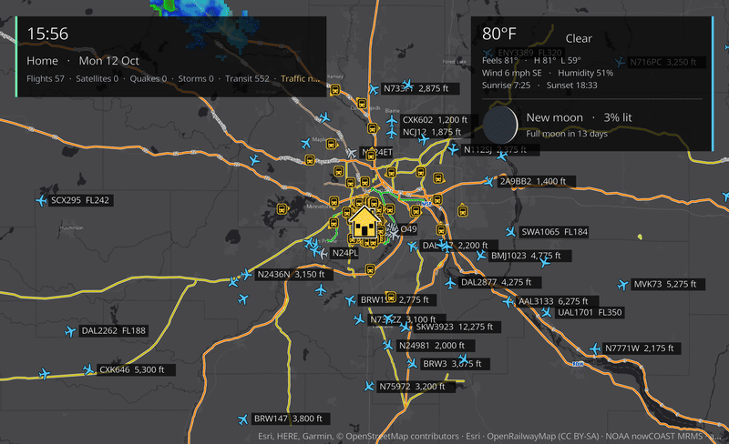
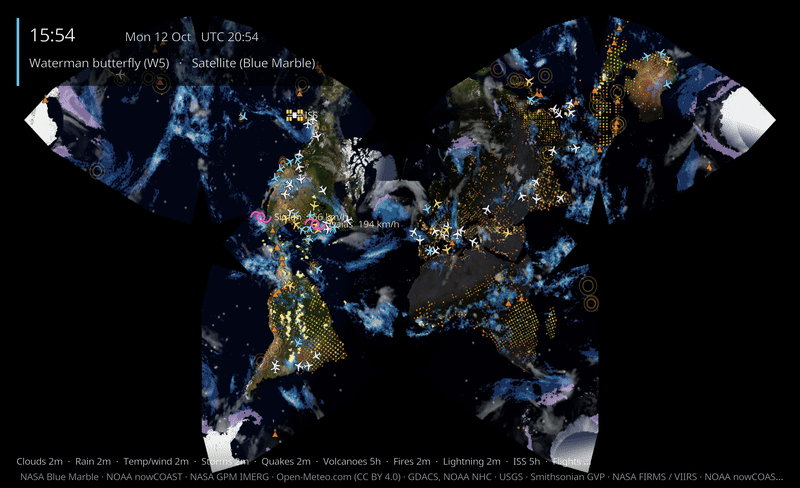
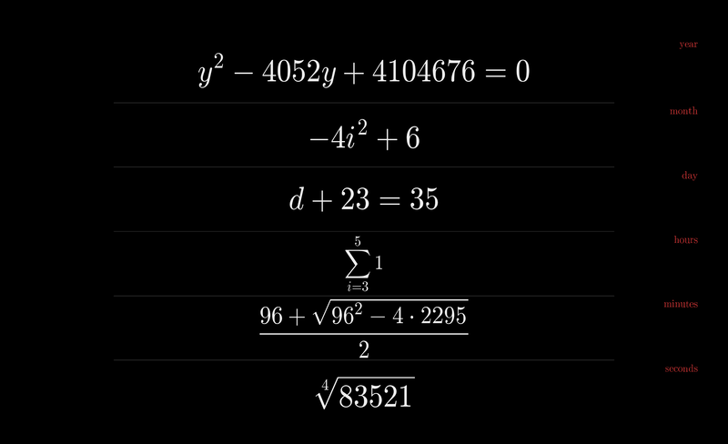
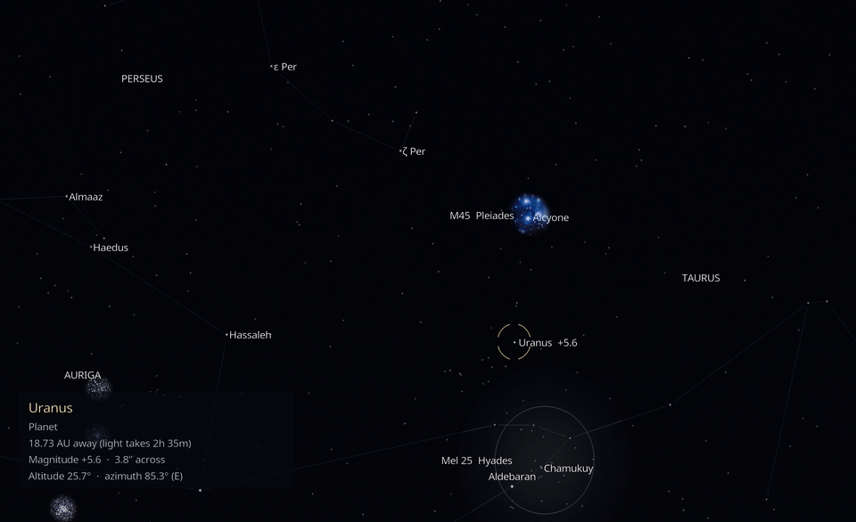

# P-Hoep Kodi Add-ons

Four ambient screensavers and a scheduler for Kodi, published as one Kodi repository so
Kodi installs them and keeps them up to date.

| Add-on | Version | What it is |
|---|---|---|
| [God's Eye Map](#gods-eye-map) | 0.2.2 | A live map of your area: flights, satellites, weather, traffic and transit |
| [God's World Map](#gods-world-map) | 0.1.1 | The whole Earth in thirteen projections, with live weather and events |
| [Math Clock](#math-clock) | 0.1.1 | The date and time as maths puzzles, typeset like LaTeX |
| [Couchstronomy](#couchstronomy) | 0.1.3 | Your TV as a window onto the real night sky |
| [Screensaver Switcher](#screensaver-switcher) | 0.1.0 | Different screensavers at different times of day |

All of them are pure Python with no compiled code. They run on Kodi 19 (Matrix) and later,
on any platform. They were developed and tested on Kodi 21 on macOS. God's Eye Map has
also been tested on Amazon Fire TV Sticks.

---

## Install

The add-ons are in a Kodi repository hosted on GitHub Pages:
**https://p-hoep.github.io/kodi/**

1. **Settings → System → Add-ons → Unknown sources → On.**
2. **Settings → File manager → Add source →** enter `https://p-hoep.github.io/kodi/`
   and name it `phoep`.
3. **Settings → Add-ons → Install from zip file → phoep →** `repository.phoep-1.0.0.zip`.
   Kodi shows "P-Hoep Add-ons — Add-on installed".
4. **Settings → Add-ons → Install from repository → P-Hoep Add-ons.** The screensavers are
   under **Look and feel → Screensaver**, and the Switcher is under **Services**.
5. To turn one on, go to **Settings → Interface → Screensaver → Screensaver mode**, pick it,
   then open **Settings** below it to configure it. **Preview** starts it straight away.

Kodi checks the repository for new versions and updates installed add-ons automatically.
To check now, open **Add-ons → My add-ons**, open the add-on and choose **Update**. Some
add-ons also need `script.module.certifi`, which Kodi installs from its official
repository by itself.

---

## God's Eye Map

A live map of a place you choose, inspired by Bilawal Sidhu's *God's Eye View*. Pick the
location, the zoom and a base map: street, dark, satellite, or NASA's satellite image of
the day. Then turn on the layers you want:

- **Air and space:** live flights with call signs and altitudes, military aircraft, and
  satellites overhead (space stations, the 100 brightest, GPS, weather or Starlink),
  computed on the device from CelesTrak orbits.
- **Weather and Earth:** rain radar (US), infrared clouds, lightning (Americas),
  earthquakes and tropical storms.
- **Getting around:** rail, subway and tram lines worldwide, live transit vehicles in
  cities with open feeds, and traffic flow and incidents (needs a free TomTom key).
- **Weather card:** local conditions and the moon phase.
- **Looks:** optional sensor styles (night vision, FLIR, CRT), dimming and a slow drift to
  protect OLED and plasma screens.

Most layers need no account. To find a place, type its name in **Find a place by name…**
in the settings.

Data from adsb.lol, OpenSky Network, CelesTrak, USGS, NOAA, NASA GIBS, OpenRailwayMap,
transit agencies and TomTom. Map tiles © OpenStreetMap contributors, CARTO and Esri.

## God's World Map

The whole Earth as an ambient world map. It shows thirteen projections:

- **Classics:** Mercator, Robinson, Winkel tripel, Equal Earth, Gall–Peters and
  cylindrical equal-area.
- **Interrupted maps:** Goode homolosine and Sinu-Mollweide.
- **Unusual ones:** Fuller's Dymaxion, Peirce's quincuncial square, an octahedral
  butterfly, Waterman's butterfly on his W5 polyhedron, and a spinning globe.

Each projection can use a satellite, relief, OpenStreetMap or atlas base map, or be drawn
as **Dwarf Fortress-style ASCII art**, either from geography or from satellite imagery.

Layers:

- **Weather:** infrared clouds, precipitation, temperature, flowing wind particles and
  tropical storms.
- **Events:** earthquakes, erupting volcanoes, wildfires from yesterday's satellite
  passes, lightning, live flights and the International Space Station.
- **Light:** the moving day/night line and city lights on the night side.

It can cycle through projections and styles on a timer, pan or rotate slowly, and keep
working from cached data when the network drops.

Data from NASA (Blue Marble, GIBS, GPM IMERG, FIRMS), NOAA (nowCOAST, NHC), GDACS, USGS,
the Smithsonian Global Volcanism Program, Open-Meteo.com (CC BY 4.0), Natural Earth and
Mapzen terrain tiles. Map tiles © OpenStreetMap contributors, © CARTO.

## Math Clock

A clock you solve. The year, month, day, hours, minutes and seconds each appear as a random
equation whose answer is the current value, typeset in Computer Modern like a LaTeX
document. For example, `√144` might stand for the hour, and `log₃(m + 32) = 4` for the
minute.

It is based on the web clock themathclock.com and keeps all its settings: seconds, 24-hour
time, the date, labels, inverted colours and day/night mode.

There are three equation sets:

- **Classic:** the original 17 puzzles.
- **Advanced:** fractions, powers, logarithms, sums, binomials and floors.
- **Algebra 2** (the default): mixes both with quadratics, linear systems, exponential and
  log equations, radicals, absolute values, function composition and inverses, complex
  numbers, sequences and series, 2×2 determinants, permutations and combinations.

Every puzzle has exactly one answer. When a quadratic has two roots, the puzzle says which
one it means.

Equations fade from one to the next, and a slow drift protects OLED screens. It is light
enough for a Fire TV Stick.

Glyphs are rendered from the BaKoMa Computer Modern fonts, as shipped with matplotlib.

## Couchstronomy

*This clip is real time sped up 6×.*

Tell Couchstronomy where your TV is and which way it faces: compass heading, tilt, and
field of view (or screen width and viewing distance). It then shows the patch of sky that
would be outside that window right now, computed for the real time.

**What it shows:**

- About 41,000 stars down to magnitude 8, from the Hipparcos-based HYG catalogue.
- The Sun, and the Moon with its phase and earthshine.
- The planets, with their phases and Saturn's rings.
- Messier and bright NGC objects, shown as real photographs.
- Constellation lines and boundaries.
- Live satellites that cross the screen when they really pass.

Stars drift as the Earth turns. Twilight, daylight, moonlight, light pollution,
atmospheric extinction and refraction are all modelled.

**Labels** can be off (a quiet natural sky), on for named objects, or in **Explorer** mode.
Explorer spotlights one object every 30 seconds with its distance, magnitude, altitude and
azimuth.

**Rendering** is *Realistic* by default: you see only what the eye could, and faint stars
fade out in twilight and moonlight. *Enhanced* brightens faint stars and enlarges the Moon
and planets.

**Accuracy:** stars, Sun and planets are within 5″, the Moon within 10″ and the ISS within
0.02°, checked against JPL ephemerides for 2020–2030. On screen, any error comes from how
precisely you enter your TV's heading, not from the astronomy.

It works offline from the bundled catalogues. Satellite orbits refresh from CelesTrak when
the device is online.

Data: HYG database (CC BY-SA 4.0), d3-celestial (BSD), VSOP87 via astronomia (MIT), NASA
SVS Moon imagery and CelesTrak. The Messier photographs are by Fred Espenak
(AstroPixels.com), used with permission and **not** covered by the MIT licence.

## Screensaver Switcher

A service that picks a different screensaver for different times of day. For example: Math
Clock in the morning, God's World Map during the day, and Black at night.

- **Time windows:** set up to six, each with a start time, an end time and a screensaver
  chosen from the ones you have installed. A default covers the rest of the day.
- **Alternating:** a window can switch between two screensavers every 5–240 minutes.
- **Flexible windows:** a window can cross midnight (22:00–06:00). If two windows
  overlap, the lower-numbered one wins.
- **Instant switching:** at each window boundary it changes Kodi's screensaver, and
  restarts one that is already running so the change shows within a second or two.
- **Manual choices stick:** a screensaver you pick by hand stays until the next window
  boundary.

Open **Programs → Screensaver Switcher** to see what is scheduled now, apply the schedule,
preview it or change the settings.

---

## Licence

The add-on code is MIT-licensed. Bundled data and imagery keep their own licences, listed
above and in each add-on's `LICENSE.txt` or `addon.xml`.

All data comes from public sources. It is for personal use, so follow each provider's
terms. Positions of flights, satellites and events are as accurate as the feeds they come
from.
