# P-Hoep Kodi Add-ons

Ambient screensavers, a word clock, a sand clock, a Jeopardy! slideshow, a weather station, a
live-camera window, a bird-sighting mosaic, a street-view guessing game, an old radar scope, a ship
tracker, a scheduler, a flashcard app, a trivia quiz, a news reader, audiobooks and GPU-drawn
visuals for Kodi, published as one Kodi repository so Kodi installs them and keeps them up to date.

### Python screensavers

| Add-on | Version | What it is |
|---|---|---|
| [God's Eye Map](#gods-eye-map) | 0.2.2 | A live map of your area: flights, satellites, weather, traffic and transit |
| [God's World Map](#gods-world-map) | 0.1.1 | The whole Earth in thirteen projections, with live weather and events |
| [Math Clock](#math-clock) | 0.1.1 | The date and time as maths puzzles, typeset like LaTeX |
| [Couchstronomy](#couchstronomy) | 0.1.3 | Your TV as a window onto the real night sky |
| [SkyWatch](#skywatch) | 1.0.0 | A live weather station: radar, forecasts, warnings and conditions |
| [Live Cams](#live-cams) | 1.0.0 | A window onto public live cameras around the world |
| [GeoGuess](#geoguess) | 0.4.0 | A random street-view panorama, answered after a few sweeps |
| [Vintage Radar](#vintage-radar) | 1.0.1 | An old radar scope showing the aircraft flying over you right now |
| [Word Clock](#word-clock) | 1.0.0 | The time in words on a grid of letters, with your own fonts and colours |
| [Sand Clock](#sand-clock) | 1.0.1 | A clock whose digits crumble into falling sand every second |
| [Jeopkodi](#jeopkodi) | 1.1.0 | An endless Jeopardy! slideshow: clue, then the response |
| [OpenTrivia](#opentrivia) | 1.0.0 | A trivia question, a countdown, then the answer |
| [DVD Logo](#dvd-logo) | 1.0.1 | The classic bouncing DVD logo, with corner tricks |
| [Tetris AI](#tetris-ai) | 1.1.1 | An AI plays Tetris edge to edge, with a clock made of blocks |
| [Sheetcards Screensaver](#sheetcards) | 1.0.0 | Flashcards from a Google Sheet: an app to study with and a screensaver |
| [RSS Live Tiles Screensaver](#rss-live-tiles) | 1.0.0 | Your RSS and Atom feeds as Windows Phone style live tiles: an app and a screensaver |
| [Hacker News](#hacker-news) | 0.1.0 | The Hacker News front page and its best comments, paced to reading speed |
| [Ship Tracker](#ship-tracker) | 0.3.0 | Live ships in up to ten areas you choose, rotating on a timer, on Sentinel-2 satellite maps, with ship photos |
| [Local Bird Sightings](#local-bird-sightings) | 1.0.0 | Recent bird sightings near you as a living photo mosaic, with occasional spotlight cards |

### Native screensavers and visualisation (OpenGL / OpenGL ES, Kodi 21)

| Add-on | Version | Platforms |
|---|---|---|
| [Tetris AI (OpenGL)](#tetris-ai-opengl) | 1.0.2 | macOS, Android 64-bit |
| Tetris AI (OpenGL, 32-bit Android) | 1.0.2 | Android 32-bit |
| [Endless World (OpenGL)](#endless-world-opengl) | 1.0.1 | macOS, Android 64-bit |
| Endless World (OpenGL, 32-bit Android) | 1.0.1 | Android 32-bit |
| [Growing Plant (OpenGL)](#growing-plant-opengl) | 1.0.1 | macOS, Android 64-bit |
| Growing Plant (OpenGL, 32-bit Android) | 1.0.1 | Android 32-bit |
| [Sand Clock (OpenGL)](#sand-clock-opengl) | 1.0.0 | macOS, Android 64-bit |
| Sand Clock (OpenGL, 32-bit Android) | 1.0.0 | Android 32-bit |
| [Cellular Automata (32-bit Android)](#cellular-automata) | 1.1.0 | Android 32-bit |
| [Cellular Automata Lite (32-bit Android)](#cellular-automata) | 1.1.0 | Android 32-bit |
| [Cellular Automata 3D (32-bit Android)](#cellular-automata-3d) | 1.0.0 | Android 32-bit |
| [Liquid Clock (32-bit Android)](#liquid-clock) | 1.1.0 | Android 32-bit |
| [Physarum (32-bit Android)](#physarum) | 1.0.0 | Android 32-bit |
| [Physarum Lite (32-bit Android)](#physarum-lite) | 1.3.0 | Android 32-bit |
| [Physarum Visualisation (macOS and 64-bit Android)](#physarum-visualisation) | 1.0.0 | macOS, Android 64-bit |
| Physarum Visualisation (32-bit Android) | 1.0.0 | Android 32-bit |

### Apps, services and library modules

| Add-on | Version | What it is |
|---|---|---|
| [Screensaver Switcher](#screensaver-switcher) | 0.1.0 | Different screensavers at different times of day |
| [Audioshelf](#audioshelf) | 1.1.0 | Audiobooks from an Audiobookshelf server |
| [Sheetcards](#sheetcards) | 1.0.0 | The flashcard study app |
| [OpenTrivia](#opentrivia) | 1.0.0 | The trivia quiz you play with the remote |
| [Vintage Radar](#vintage-radar) | 1.0.2 | The radar scope in a window you can drive with the remote |
| [RSS Live Tiles](#rss-live-tiles) | 1.0.0 | The live-tile news reader |

The library modules `script.module.sheetcards`, `script.module.rsslivetiles`,
`script.module.opentrivia` and `script.module.vintageradar`, and the repository
`repository.phoep`, are installed automatically as dependencies.

Most add-ons are pure Python with no compiled code and run on Kodi 19 (Matrix) or later, on any
platform. Sheetcards, RSS Live Tiles, OpenTrivia, Vintage Radar and Hacker News need Kodi 20
or later. The
OpenGL add-ons are native, built for macOS (Intel and Apple Silicon) and Android in 64-bit and
32-bit builds, and need Kodi 21. They were developed and tested on Kodi 21 on macOS; several also
on Amazon Fire TV Sticks.

The full descriptions, requirements and per-platform build matrix are in the
[repository README](../README.md). Build and publishing steps are in the
[deployment guide](../docs/deployment.md); add-on development is covered in the
[development guide](../docs/development.md).

---

## Install

The add-ons are in a Kodi repository hosted on GitHub Pages:
**https://p-hoep.github.io/kodi/**

1. **Settings → System → Add-ons → Unknown sources → On.**
2. **Settings → File manager → Add source →** enter `https://p-hoep.github.io/kodi/`
   and name it `phoep`.
3. **Settings → Add-ons → Install from zip file → phoep →** `repository.phoep-1.0.16.zip`.
   Kodi shows "P-Hoep Add-ons — Add-on installed".
4. **Settings → Add-ons → Install from repository → P-Hoep Add-ons.** Screensavers are under
   **Look and feel → Screensaver**; the Switcher is under **Services**; Sheetcards, RSS Live
   Tiles, OpenTrivia and Vintage Radar are under **Program add-ons**; Audioshelf is under
   **Music add-ons**; Physarum Visualisation is chosen from **Settings → Player → Music →
   Visualisation** while a song plays. Sheetcards, RSS Live Tiles, OpenTrivia, Vintage Radar and
   Hacker News need Kodi 20+, and the OpenGL add-ons need Kodi 21.
5. To turn one on, go to **Settings → Interface → Screensaver → Screensaver mode**, pick it,
   then open **Settings** below it to configure it. **Preview** starts it straight away.

Kodi checks the repository for new versions and updates installed add-ons automatically.
To check now, open **Add-ons → My add-ons**, open the add-on and choose **Update**. Some
add-ons also need `script.module.certifi`, which Kodi installs from its official
repository by itself.

---

## God's Eye Map

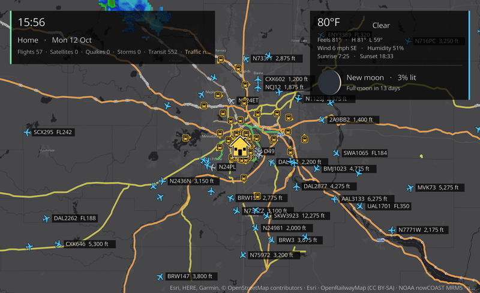

A live map of a place you choose, inspired by Bilawal Sidhu's *God's Eye View*. Pick the
location, the zoom and a base map: street, dark, satellite, or NASA's satellite image of
the day. Then turn on the layers you want:

- **Air and space:** live flights with call signs and altitudes, military aircraft, and
  satellites overhead (space stations, the 100 brightest, GPS, weather or Starlink),
  computed on the device from CelesTrak orbits.
- **Weather and Earth:** rain radar (US), infrared clouds, lightning (Americas),
  earthquakes and tropical storms.
- **Getting around:** rail, subway and tram lines worldwide, live transit vehicles in
  cities with open feeds, and traffic flow and incidents (needs a free TomTom key).
- **Weather card:** local conditions and the moon phase.
- **Looks:** optional sensor styles (night vision, FLIR, CRT), dimming and a slow drift to
  protect OLED and plasma screens.

Most layers need no account. To find a place, type its name in **Find a place by name…**
in the settings.

Data from adsb.lol, OpenSky Network, CelesTrak, USGS, NOAA, NASA GIBS, OpenRailwayMap,
transit agencies and TomTom. Map tiles © OpenStreetMap contributors, CARTO and Esri.

## God's World Map

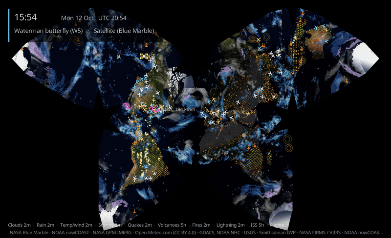

The whole Earth as an ambient world map. It shows thirteen projections:

- **Classics:** Mercator, Robinson, Winkel tripel, Equal Earth, Gall–Peters and
  cylindrical equal-area.
- **Interrupted maps:** Goode homolosine and Sinu-Mollweide.
- **Unusual ones:** Fuller's Dymaxion, Peirce's quincuncial square, an octahedral
  butterfly, Waterman's butterfly on his W5 polyhedron, and a spinning globe.

Each projection can use a satellite, relief, OpenStreetMap or atlas base map, or be drawn
as **Dwarf Fortress-style ASCII art**, either from geography or from satellite imagery.

Layers:

- **Weather:** infrared clouds, precipitation, temperature, flowing wind particles and
  tropical storms.
- **Events:** earthquakes, erupting volcanoes, wildfires from yesterday's satellite
  passes, lightning, live flights and the International Space Station.
- **Light:** the moving day/night line and city lights on the night side.

It can cycle through projections and styles on a timer, pan or rotate slowly, and keep
working from cached data when the network drops.

Data from NASA (Blue Marble, GIBS, GPM IMERG, FIRMS), NOAA (nowCOAST, NHC), GDACS, USGS,
the Smithsonian Global Volcanism Program, Open-Meteo.com (CC BY 4.0), Natural Earth and
Mapzen terrain tiles. Map tiles © OpenStreetMap contributors, © CARTO.

## Math Clock

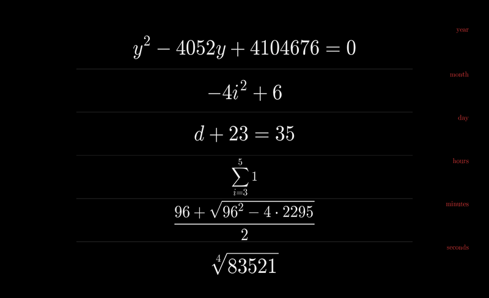

A clock you solve. The year, month, day, hours, minutes and seconds each appear as a random
equation whose answer is the current value, typeset in Computer Modern like a LaTeX
document. For example, `√144` might stand for the hour, and `log₃(m + 32) = 4` for the
minute.

It is based on the web clock themathclock.com and keeps all its settings: seconds, 24-hour
time, the date, labels, inverted colours and day/night mode.

There are three equation sets:

- **Classic:** the original 17 puzzles.
- **Advanced:** fractions, powers, logarithms, sums, binomials and floors.
- **Algebra 2** (the default): mixes both with quadratics, linear systems, exponential and
  log equations, radicals, absolute values, function composition and inverses, complex
  numbers, sequences and series, 2×2 determinants, permutations and combinations.

Every puzzle has exactly one answer. When a quadratic has two roots, the puzzle says which
one it means.

Equations fade from one to the next, and a slow drift protects OLED screens. It is light
enough for a Fire TV Stick.

Glyphs are rendered from the BaKoMa Computer Modern fonts, as shipped with matplotlib.

## Couchstronomy

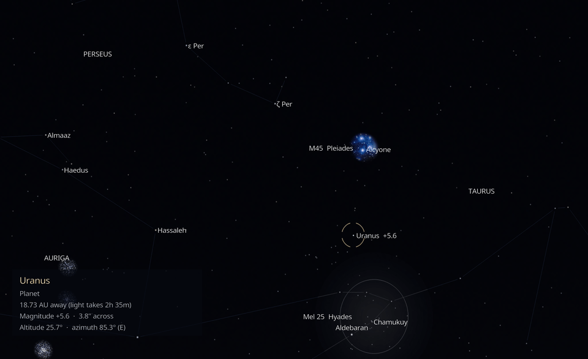

*This clip is real time sped up 6×.*

Tell Couchstronomy where your TV is and which way it faces: compass heading, tilt, and
field of view (or screen width and viewing distance). It then shows the patch of sky that
would be outside that window right now, computed for the real time.

**What it shows:**

- About 41,000 stars down to magnitude 8, from the Hipparcos-based HYG catalogue.
- The Sun, and the Moon with its phase and earthshine.
- The planets, with their phases and Saturn's rings.
- Messier and bright NGC objects, shown as real photographs.
- Constellation lines and boundaries.
- Live satellites that cross the screen when they really pass.

Stars drift as the Earth turns. Twilight, daylight, moonlight, light pollution,
atmospheric extinction and refraction are all modelled.

**Labels** can be off (a quiet natural sky), on for named objects, or in **Explorer** mode.
Explorer spotlights one object every 30 seconds with its distance, magnitude, altitude and
azimuth.

**Rendering** is *Realistic* by default: you see only what the eye could, and faint stars
fade out in twilight and moonlight. *Enhanced* brightens faint stars and enlarges the Moon
and planets.

**Accuracy:** stars, Sun and planets are within 5″, the Moon within 10″ and the ISS within
0.02°, checked against JPL ephemerides for 2020–2030. On screen, any error comes from how
precisely you enter your TV's heading, not from the astronomy.

It works offline from the bundled catalogues. Satellite orbits refresh from CelesTrak when
the device is online.

Data: HYG database (CC BY-SA 4.0), d3-celestial (BSD), VSOP87 via astronomia (MIT), NASA
SVS Moon imagery and CelesTrak. The Messier photographs are by Fred Espenak
(AstroPixels.com), used with permission and **not** covered by the MIT licence.

## SkyWatch

A live weather station screensaver. An animated radar loop over a map of your location runs into
a future-radar extension with a PAST / NOW / FUTURE timeline, followed by a playlist of scenes
you can switch on and reorder: regional radar with NWS warning polygons, a national mosaic,
satellite + radar, "what's coming", current conditions, the next 2 hours, a 48-hour graph, 7 or
10 daily cards, today against the 1991–2020 normal, air quality and pollen, marine and tides, the
NWS forecast discussion, and an ambient clock. Active warnings pin a banner to every scene.

- **Keyless by default:** IEM NEXRAD and HRRR, Open-Meteo, NWS, NOAA CO-OPS, USGS, NASA GIBS and
  Esri/OpenStreetMap, with RainViewer outside the US. Optional keys add a global nowcast, a
  LibreWXR server and Stadia terrain.
- **Degrades quietly:** each source is OK, Stale or Down; failed sources back off, the radar
  chain falls back, scenes with no data are skipped, and with no network it runs from cache.
- **A background service** warms data in the half hour before Kodi's screensaver would start and
  sleeps during playback.
- **Interactive mode** reopens SkyWatch as a normal window where left/right skip scenes, up/down
  zoom, OK pauses and Back exits.

Data: IEM, Open-Meteo (CC BY 4.0), NWS/NOAA, USGS, NASA GIBS, RainViewer, Esri and
OpenStreetMap contributors.

## Live Cams

A window onto live outdoor scenes. It rotates through public camera feeds from the
Live-Environment-Streams dataset (beaches, mountains, lakes, harbours, towns; traffic cameras
optional), with a small overlay giving the place, the source and the local time there.

- **Choosing a camera:** a weighted draw that favours places in daylight, HD streams and your
  favourites, and avoids what was shown recently. Dead feeds are probed away in 4 seconds.
- **Self-healing:** failures are remembered and sources that keep failing are skipped; after
  repeated failures, or with no network, a fallback card with a clock shows.
- **Safe with your media:** if your own video or music is loaded it shows only a clock and never
  touches the player. Any input exits at once. Streams are muted unless *Play audio* is on, and
  after 2 hours it switches to a clock that uses no network.
- **Catalogue:** downloaded at run time and cached, since the dataset has no licence yet.

The default pool is about 282 playable cameras; health tracking learns the dead ones.

## GeoGuess

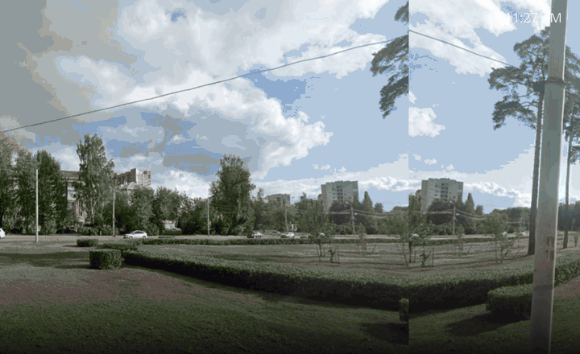

A guessing game on the idle screen. Each location is a random street-view panorama from around
the world, filling the screen height and panning slowly, as many times back and forth as you
choose. The answer appears only when the final pass begins, so every earlier sweep is played
without it; after a while the next panorama crossfades in.

- **Unseen places:** rows are fetched in a shuffled batch from a random offset, and the last 200
  shown are skipped.
- **Timing:** reveal the answer 8 seconds into the final pass (1–60) and show each place for 25
  seconds (5–120) per pass. With three passes the name stays hidden for two full sweeps.
- **Repeats:** pan one to ten times back and forth over the same panorama before moving on.
- **Map answer:** a zoomed satellite map centred on the row's latitude and longitude, with a pin
  on the spot and the English country name underneath, in place of the place name. The imagery
  comes from NASA GIBS on demand.
- **Clock:** an optional fixed clock in the top right corner, as plain white text.
- **Labels:** the country's English name is appended unless the address already ends with a known
  spelling of it; label size small, medium or large.
- **Images:** wide panoramas pan with a sine ease, narrow ones are centred; the next image is
  prefetched, and at most eight files are kept in Kodi's temp folder and deleted on exit.
- **Offline:** black screen with a retry message, backing off to once a minute and resuming when
  the connection returns. Any input exits immediately.

The panoramas, place names and answer maps are streamed at run time from the Hugging Face
dataset `yunusserhat/random_streetview_images` and NASA GIBS. The street-view imagery is © Google
and its contributors and is subject to Google's terms; the add-on is not affiliated with Google.
The Blue Marble map imagery is in the public domain.

## Vintage Radar

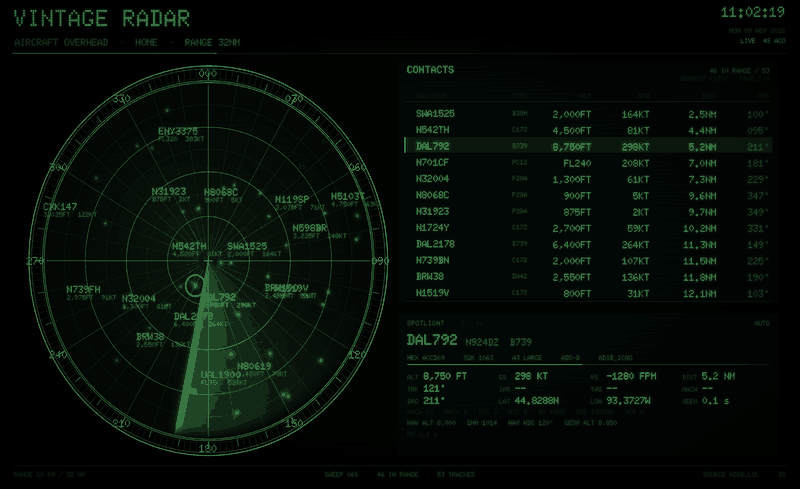

An old radar scope for the idle screen, showing the aircraft flying over you right now: a green
(or amber, ice-blue or white) phosphor disc with range rings, a compass rose, a sweeping beam and
glowing blips. Contacts are dead-reckoned between feeds so they glide instead of jumping, and the
last three sweep echoes stay on the glass.

- **The scope:** range rings with distance labels, a rotating sweep, aircraft-shaped blips with
  short labels, and ground traffic and low-altitude filters.
- **The contacts panel:** a nearest-first list (callsign, type, altitude, ground speed, distance,
  bearing) and a spotlight card that rotates through every contact with the full transponder
  picture: registration, squawk, category, hex, speeds, headings, vertical rates, position,
  QNH, signal quality and the fix source. Turn the panel off for a full-screen scope.
- **Looks:** four phosphors, CRT scanlines and vignette, dimming, and a detail setting for slow
  boxes.
- **The app** (`script.vintageradar`) is the same scope in a window you can drive: click a blip,
  a label or a list row for a three-column contact sheet with every field; Left and Right step
  the spotlight, Page Up and Page Down turn the list, Menu opens the settings and Back leaves
  the scope. Both front-ends run the same session from the shared library
  `script.module.vintageradar`, which Kodi installs with them.

**Find a place by name** in the settings searches by name or takes `lat, lon`, and writes the
coordinates to both add-ons. The feed is adsb.lol, with the OpenSky Network as a fallback; both
are volunteer-run and used as-is, and are not for navigation or flight safety. adsb.lol data is
ODbL.

It needs Kodi 20 (Nexus) or later. The screensaver is under **Look and feel → Screensaver** and
the app under **Program add-ons**.

## Screensaver Switcher

A service that picks a different screensaver for different times of day. For example: Math
Clock in the morning, God's World Map during the day, and Black at night.

- **Time windows:** set up to six, each with a start time, an end time and a screensaver
  chosen from the ones you have installed. A default covers the rest of the day.
- **Alternating:** a window can switch between two screensavers every 5–240 minutes.
- **Flexible windows:** a window can cross midnight (22:00–06:00). If two windows
  overlap, the lower-numbered one wins.
- **Instant switching:** at each window boundary it changes Kodi's screensaver, and
  restarts one that is already running so the change shows within a second or two.
- **Manual choices stick:** a screensaver you pick by hand stays until the next window
  boundary.

Open **Programs → Screensaver Switcher** to see what is scheduled now, apply the schedule,
preview it or change the settings.

---

## Audioshelf

A music add-on for the audiobooks on an [Audiobookshelf](https://www.audiobookshelf.org/)
server. It opens on Continue Listening, Recently Added, All Audiobooks, Series (in reading
order), Authors, Genres and Search, plus **Play a random book**, and every book shows its cover
and progress.

- **Sign in once:** enter the server address, username and password in the add-on; it keeps and
  renews the server's tokens itself. An API key still works. Nothing about the server is built
  in.
- **Playback** uses Kodi's own player on the book's original files. A book's page offers Resume,
  Play from start, Chapters and About this book; a finished book starts again from the beginning.
- **Progress** goes back to Audiobookshelf every 30 seconds, on pause and on stop, from a small
  background service, with the position kept locally and sent later if the server is unreachable.
- **Skip back / forward** by your own steps with a keymap entry.

It was renamed from `plugin.audio.audiobookshelf` to avoid clashing with another add-on. If you
had the old one, uninstall it and sign in again.

---

## Sheetcards

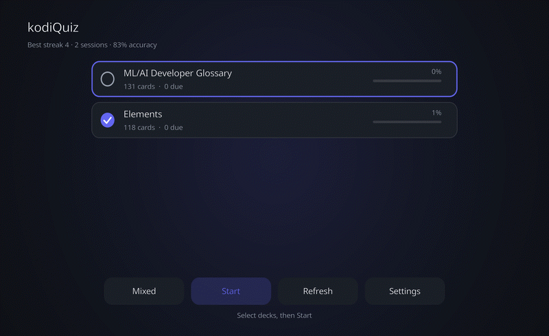

Flashcards from any Google Sheet: an app you study with, and a screensaver that plays the
cards by itself. Put questions in column A and answers in column B. Every tab is a deck.
Share the sheet as "Anyone with the link can view" and paste its ID or link in the settings.
It needs no Google account or API key.

- **Three modes:** Flashcard (the card flips to the answer), Multiple choice (3 or 4
  options) and Mixed. Wrong options come from the deck's other answers, picked to look
  plausible: years with years, single words with single words, similar lengths.
- **The app:** pick decks, then answer with the remote, a mouse or a touch screen (number
  keys 1–4 answer directly). You get a score, streaks, and a results screen listing the
  cards you missed, with **Review missed**.
- **Spaced repetition:** Leitner boxes bring cards back after 1, 2, 4, 8 and 16 days. A
  missed card comes back 3–5 cards later in the same session.
- **The screensaver:** a question with a timer bar, then the answer, card after card. Any
  key exits at once. The card drifts slightly at each change to protect OLED screens. It
  can also show a clock and dim after a while.
- **Looks and offline use:** Night, Day or Auto themes with six accent colours or your own.
  Cards are cached, so they keep working without a network.

The app is under **Program add-ons** and the screensaver under **Look and feel →
Screensaver**. By default the screensaver uses the app's sheet and decks.

---

## RSS Live Tiles

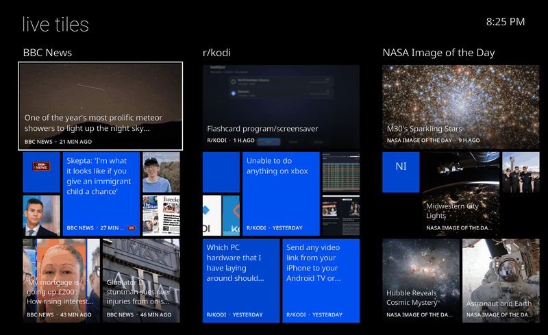

Your RSS and Atom feeds as a wall of flat, coloured live tiles, in the style of Windows Phone
and the Windows 8 Start screen. It comes as an app you browse with the remote and a screensaver
that runs by itself. Three sample feeds are included (BBC News, r/kodi and NASA Image of the
Day). Add your own in **Manage feeds**.

- **Live tiles:** pictures come from the feeds themselves. Tiles flip to the next story, peek
  from the picture to the headline and summary, and count new items. Calm, Normal or Lively, or
  fades only with Reduced motion.
- **Five layouts and three styles:** Feed groups (a scrolling hub with one group per feed),
  Mixed wall, Magazine, Spotlight and Mosaic, in Classic, Modern or Outline style.
- **Your colours:** the 20 Windows Phone accent colours or your own, a different accent per feed
  if you like, and Night / Day themes that can switch by the clock or at sunrise and sunset.
- **Read the story:** Select expands a tile into the full story with a QR code to open it on your
  phone. Left and Right go through the feed. Podcast and video enclosures play straight away.
- **Feeds:** add, edit, reorder and delete them in the app, or import and export OPML. They
  refresh in the background and everything works offline from the cache.
- **The screensaver:** fills the screen with tiles, rotates fresh stories in every few minutes,
  can show a clock, dims at night and shifts slightly to protect OLED screens. Any key exits
  at once.

The app is under **Program add-ons** (press **Menu** on a tile for Manage feeds, layouts and
settings) and the screensaver under **Look and feel → Screensaver**. By default the screensaver
uses the app's feeds and look.

---

## Hacker News

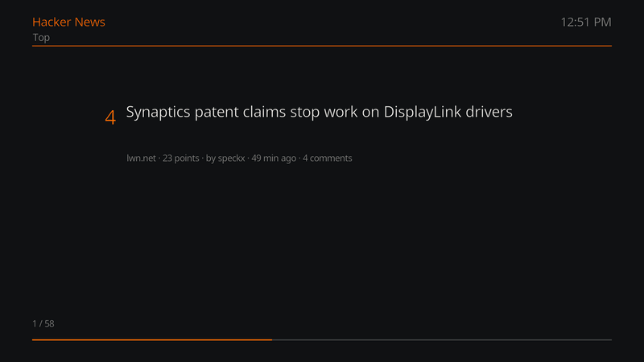

The Hacker News front page as a screensaver, read at reading speed. Each story gets a slide with
its rank, title, domain, points, author, age and comment count; its top comments follow, one at a
time, for as long as they take to read. Choose Top, Best, New, Ask or Show, the number of stories
and comments, whether the first reply comes along, the reading speed, and the theme.

- **Comments as text:** paragraphs, line breaks, italics, indented code blocks, entities and links
  are reduced to clean text, with literal brackets turned into parentheses so nothing can be read
  as a Kodi tag. Long comments are cut at a sentence or word boundary.
- **Timed to read:** a comment's time on screen is its word count at your words per minute,
  clamped to a minimum and maximum; the progress bar shows how much is left.
- **Always something to show:** the last fetch is cached, so it starts instantly and keeps playing
  offline; it refreshes in the background and marks itself offline when a refresh fails.
- **Kind to the panel:** three themes, an optional clock and a slow drift for OLED and plasma.
- **Read-only:** it uses Hacker News' public API and nothing else — no account, no votes, no
  comments, no telemetry.

Under **Look and feel → Screensaver**. Needs Kodi 20 or later.

---

## Ship Tracker

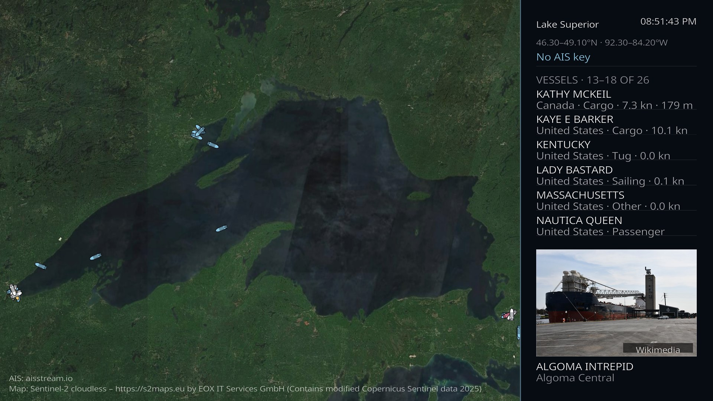

A live map of the ships in up to ten areas you choose, moving on from one to the next on a timer.
The left of the screen is a Copernicus Sentinel-2 satellite image of the current area, sharp enough
to see harbours, locks and berths, with a top-down ship marker for every AIS-equipped vessel,
coloured by type and turned to its course. The right-hand panel lists the ships six at a time —
name, flag state, type, speed, length and voyage status — and a slideshow underneath shows
photographs of them, with their names, from Wikimedia Commons.

- **Ten areas, on and off:** each area has its own name and south, west, north and east edges, plus
  an **Enabled** switch. They ship filled in with Lake Superior, the Strait of Hormuz, San Diego,
  San Francisco Bay, Hawaii, the Singapore Strait, Rotterdam, the Panama Canal, the Suez Canal and
  New York Harbor. **Minutes per area before switching** (1–60, default 5) sets the rotation;
  disabled areas are skipped.
- **Anywhere on Earth:** the map window is padded to the screen with a `1/cos(latitude)` correction
  so the satellite image is not stretched. Sentinel-2 is 10 m per pixel, so the screen can zoom
  down to a harbour or a lock; a box under 0.05° tall is shown with that much surrounding water so
  it stays sharp. Each area's image is fetched in the background when the rotation reaches it.
- **Cache first:** the last state of every ship is kept in a SQLite database, so the screen has
  ships to show while the stream reconnects, and a regular visitor is not looked up again. Maps
  and photographs are cached on disk too.
- **Details and photos:** a background worker looks each ship up by IMO/MMSI on Wikidata and its
  photographs on Wikimedia Commons, then remembers the answer for a month (a week for nothing
  found).
- **A free key:** aisstream.io needs an account; paste its API key into the settings. Nothing is
  bundled and the key is never committed. The map works without it.

Under **Look and feel → Screensaver**. Needs Kodi 19 or later.

---

## Local Bird Sightings

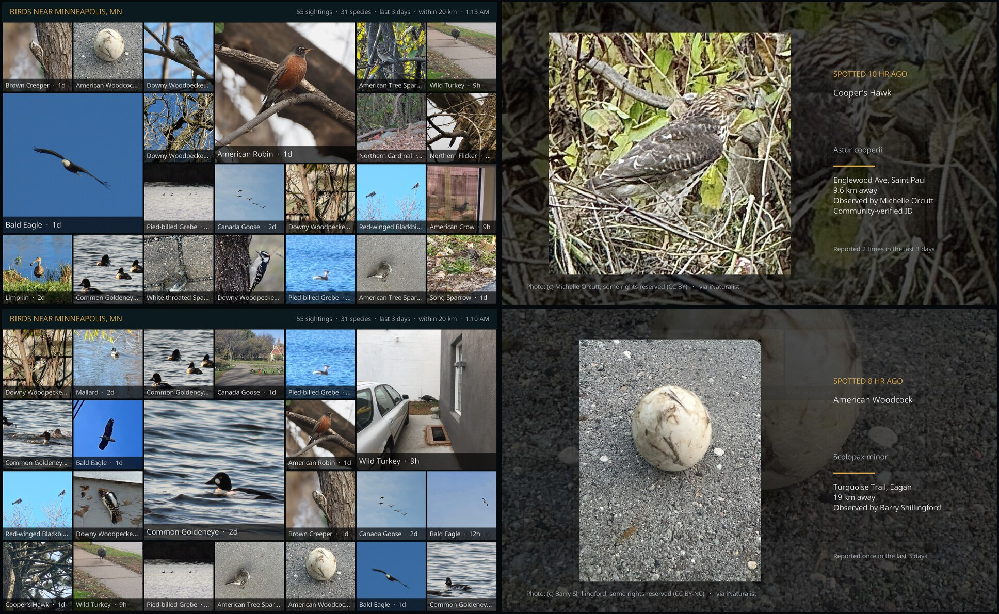

The latest bird sightings around a place you choose, as a constantly shifting mosaic of
iNaturalist photographs. Each tile is a real observation with its species and how long ago it was
seen; tiles pop and swap on their own, and every so often one sighting takes over the screen with
a large photograph, the species' common and scientific names, where it was seen, how far away, who
observed it and when.

- **A place and a window:** set the latitude and longitude (or use **Find coordinates by place
  name…**), the search radius (1–200 km) and how many days back to look (1–30). The location name
  shown on screen is yours to edit, and the header shows the counts, radius, window and clock.
- **Only birds, only photos:** observations come from iNaturalist's Aves taxon and must have a
  photo. Captive or cultivated birds are excluded by default; you can also keep only
  research-grade identifications or only photos with an open CC licence.
- **A mosaic that keeps moving:** swap a tile every few seconds, preloading the next photo behind
  the current one before it pops in, with a few large feature tiles at random and 4–12 columns.
- **Spotlights:** every 30 seconds by default (or off), one sighting fills the screen for 12
  seconds with its photographer and licence credit. Recent spotlights are not repeated.
- **Refreshes by itself:** the list is fetched again every 5–180 minutes, and the photos on screen
  stay up if the network fails.

No account or API key is needed: data and photographs come from iNaturalist and its observers,
each photo under the licence shown in its credit. The code is MIT-licensed and bundles no
photographs. Not affiliated with iNaturalist.

Under **Look and feel → Screensaver**. Needs Kodi 19 or later.

---

## Word Clock

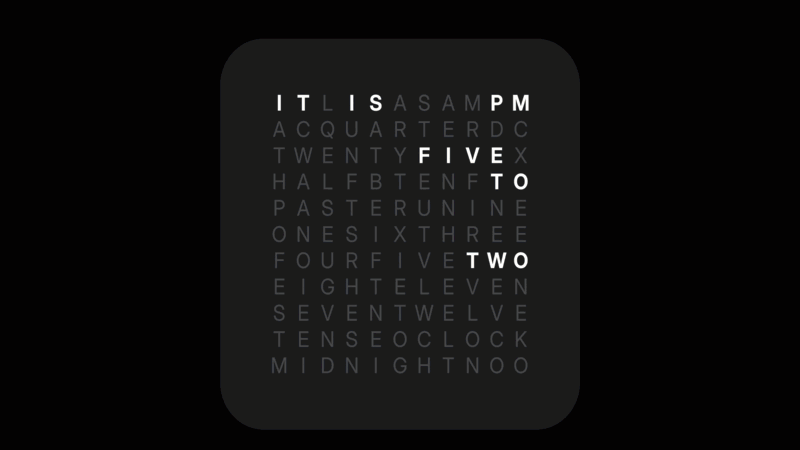

A word clock like the ones sold for walls and desks: an 11 × 11 grid of letters where the words
that tell the time light up. At 1:55 PM it reads **IT IS FIVE TO TWO PM**, and at ten past
twelve at night **IT IS TEN PAST MIDNIGHT**. Out of the box it looks like the classic graphite
word clock: bold white letters over dim grey ones on a rounded dark card.

- **Fonts:** eight to choose from: Inter (the default), Montserrat, Raleway, Playfair Display,
  JetBrains Mono, Comfortaa, a dot-matrix font and a stencil font. Lit letters can be bold.
- **Colours:** eight palettes (Graphite, Paper, Midnight blue, Amber LED, Terminal green, Rose,
  Walnut, Steel) or your own, chosen with colour pickers. Lit words can also each have their own
  colour, or slowly cycle through the rainbow. Add a soft or strong glow, and make the unlit
  letters faint or hide them.
- **Day and night:** separate day and night colours that switch at the times you set, blending
  over a few seconds, and optional dimming at night.
- **The clock:** round down (like most word clocks) or to the nearest five minutes, minute dots
  in the corners, and IT IS, A QUARTER, AM/PM and MIDNIGHT can each be turned off.
- **Screen:** a rounded card, a square card or full screen, any size, a fade or ripple when the
  time changes, dimming, and a slow drift to protect OLED screens. Any key exits at once.

It is under **Look and feel → Screensaver**.

---

## Sand Clock

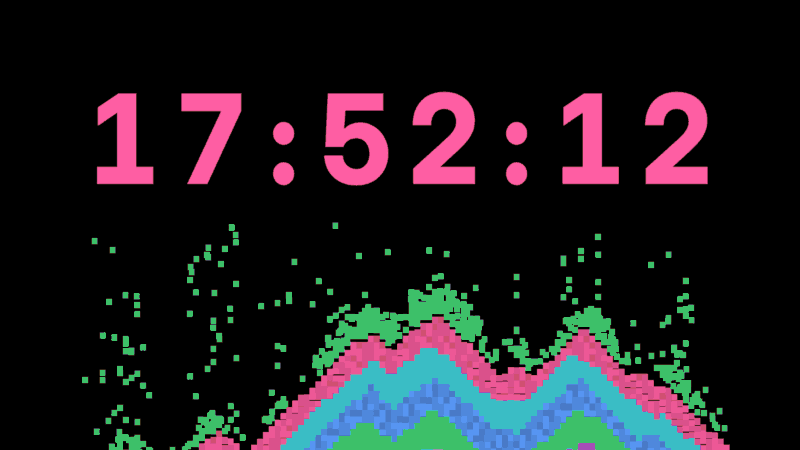

A big clock that crumbles into sand. Just before each second ticks over, the digits break into
grains that fall, scatter and slide into heaps at the bottom of the screen. Every change brings
a new colour, so the heaps build up in stripes, and they sink slowly through the floor so the
screen never fills up.

- **Fonts:** nine, from Inter and Montserrat to a digital, a pixel, a dot-matrix and a stencil
  font, in light, regular or bold.
- **Sand:** fine, medium or coarse grains that look like sand, flat squares or round beads,
  with floaty, normal or heavy gravity, and as tall a pile as you like.
- **What crumbles:** the whole clock every second, or only the digits that change. Turn seconds
  off and it crumbles once a minute.
- **Colours:** a new colour every change or for each digit, eight palettes (Neon, Desert sand,
  Ocean, Sunset, Candy, Forest, Ice, Greyscale), one colour of your own, or a slow rainbow.
- **Day and night:** a different palette at night, dimming, and a slow drift to protect OLED
  screens. Any key exits at once.

It is under **Look and feel → Screensaver**.

---

## Jeopkodi

Jeopardy! as a screensaver. A clue comes up on the classic blue screen in white capitals with a
drop shadow, just like on the show, and a few seconds later the response appears, phrased as a
question. Then the next clue. There are over half a million clues from 42 seasons, shuffled, so
it never runs out.

- **Difficulty:** easy ($200 and $400), medium ($600) and hard ($800 and $1000) clues, each on
  or off, and Daily Doubles and Final Jeopardy if you want them.
- **Timing:** how long a clue stays up before the response (long clues get a little extra), and
  how long the response stays up.
- **Display:** the category at the top, the value in Jeopardy yellow at the bottom left, and the
  clue's year at the bottom right, each on or off; WHAT IS / WHO IS phrasing or the bare
  response; text size and dimming. Any key exits at once.

It is under **Look and feel → Screensaver**. An unofficial fan project, not affiliated with
Jeopardy Productions, Inc.

---

## OpenTrivia

A trivia screensaver and a trivia app, with 49,110 questions in 22 categories from the
OpenTriviaQA collection. The screensaver shows a question, drains a countdown bar, then turns the
correct answer green with a check and the others back before moving on. The app, under
**Program add-ons**, is the same quiz played with the remote: select an answer and it tells you at
once; score, streak and the question number stay in the top bar; rounds can be 10, 20, 30, 50 or
endless, and the results screen shows your accuracy and best streak.

- **Categories:** every one has its own switch, so you can keep just science, history, movies or
  whatever you like. All 22 are on at first.
- **Timing:** how long a question stays up before the reveal, how long the answer stays up, the
  countdown bar and the clock, and a slow dim for OLED and plasma screens.
- **Look:** Ink, Paper, Midnight and Auto themes, seven accent colours or your own, custom colours
  for every part, Auto / Cards / List answer layouts, A/B/C/D letters, text size and dimming. Both
  add-ons share the same look settings, so they match.

Any key exits the screensaver at once. The questions are © the OpenTriviaQA contributors under
CC BY-SA 4.0.

---

## DVD Logo

The classic DVD screensaver: the white logo drifts across a black screen and bounces off the
edges. Left alone it behaves like the real thing, so a corner hit is rare — but the corner
tricks can make it happen.

- **Corner tricks:** *Off*, *Hit the corner* (it quietly bends its path by a few degrees at a
  bounce and then lands exactly in the corner), *Veer off at the last second* (it lines up a
  perfect hit and swerves away from the corner half a second before arriving), or *Alternate*
  (the default: hit a corner, then fake the next one). A slider sets how often it tries.
- **The logo:** any size, from a slow drift to a quick scoot.
- **Colours:** white, a new colour on every bounce (the classic), a new colour only when it
  hits a corner, a slow rainbow, or one colour of your choice; the background is any colour too.

Every move is a Kodi animation, so it is light enough for a Fire TV Stick, and any key or click
ends it at once.

It is under **Look and feel → Screensaver**. The DVD logo is a trademark of DVD Format/Logo
Licensing Corporation; this is an unaffiliated fan project.

---

## Tetris AI

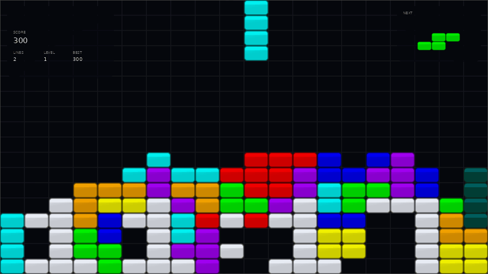

An AI plays Tetris across the whole screen, forever. The playfield is 18 rows tall and reaches
all four edges; the *block size* sets how wide the blocks are in pixels, so a wide screen can
show 20 big columns at the default 96 pixels or as many as 60 narrow ones at 32. All seven
classic tetrominoes fall in the modern Guideline shapes and colours.

- **AI skill:** *Perfect*, *Expert*, *Skilled*, *Average* or *Beginner*. Perfect always picks
  the best placement; the lower levels increasingly choose a runner-up, so the stack grows and
  the board tops out now and then before clearing itself and starting again.
- **Clock:** on by default, as text in the top-left panel or — *Clock style: Tetris blocks* —
  as HH:MM (with seconds when the board is wide enough) built from blocks on the floor or
  suspended in mid-air. The block clock is part of the game: pieces collide with the digits and
  have to be placed around them, the digits never fall, rows clear around them, and the time is
  redrawn once a minute (every second with seconds on) — a piece resting on a digit that
  vanishes falls into the gap rather than hanging in the air.
- **Look:** seven classic colours, the muted NES palette, Neon, Pastel, Monochrome, Game Boy,
  Sunset, Ocean, Vaporwave, or your own seven colours; the background is any colour, the block
  width runs from 32 to 96 pixels, and the grid, score panel, its opacity, the landing ghost and
  the next-piece preview can each be switched off.
- **Speed:** an overall slider from 25% to 400%, an optional speed-up with each level, and a
  starting level up to 10.

Any key or click ends it at once.

It is under **Look and feel → Screensaver**. Tetris is a trademark of The Tetris Company;
this is an unaffiliated fan project.

---

## Tetris AI (OpenGL)

The same AI plays the same game, but the screen is drawn in native code and OpenGL instead of by
Kodi image controls, so nothing moves in cell-sized steps: the active piece slides and falls at
sub-pixel positions on eased curves, dropped pieces land exactly where the ghost showed, a line
clear flashes twice and collapses into place, and a piece stranded on a clock digit that changes
slides down into the gap it leaves. Everything is drawn as antialiased rounded tiles, so it
stays sharp at every block size and on high-DPI screens.

It has the same 25 settings as Tetris AI: the five skill levels, speed and progressive levels,
nine colour schemes or your own seven colours, the block size (96 pixels down to 32, so 20 to 60
columns), the grid, the score panel and its opacity, the ghost and next-piece preview, the
background colour, and the clock (text or blocks, 12/24 hour, seconds, on the floor or floating,
any colour). The engine is a C++ port of the Python one, so the AI behaves the same.

This is a native add-on, so Kodi needs the build for its platform:

- **Tetris AI (OpenGL, macOS and 64-bit Android)** — macOS (Intel and Apple Silicon) and 64-bit
  Android.
- **Tetris AI (OpenGL, 32-bit Android)** — 32-bit Android Kodi: the Fire TV, many Google TV boxes
  and the Chromecast with Google TV. Install this one on those devices; the other one is for
  64-bit Android and macOS, and its library cannot load in a 32-bit Kodi.

Any key or click ends it at once. It is under **Look and feel → Screensaver**. Tetris is a
trademark of The Tetris Company; this is an unaffiliated fan project.

---

## Endless World (OpenGL)

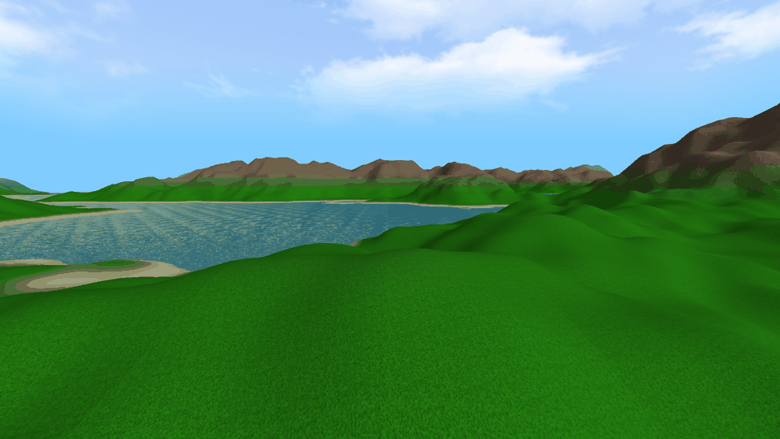

A camera flies slowly over an infinite landscape generated from noise: mountains, green hills,
sandy beaches, lakes and seas, pine and broadleaf forests, and a sky with drifting clouds.
Nothing is loaded from disk except the textures: the height of every hill and the position of
every tree come from the seed when a chunk comes into view, and the world is redrawn in five
levels of detail around the camera, so it never ends and the ground near you stays detailed.
It is a port of [infworld](https://github.com/NULLPTR-ERROR/infworld) by Jeremy Li "Nullptr
Error".

The flight can glide, circle or drift; you pick the seed (0 is a new world every start), how far
to draw, the terrain and tree detail, the tree density, the speed and the height, and whether to
look around while flying and to draw the sea. Automatic resolution and adaptive quality keep a
slow box smooth.

This is a native add-on, so Kodi needs the build for its platform:

- **Endless World (OpenGL)** — macOS (Intel and Apple Silicon) and 64-bit Android.
- **Endless World (OpenGL, 32-bit Android)** — 32-bit Android Kodi: many Google TV boxes and the
  Chromecast with Google TV. Install this one on those devices; the other one's library cannot
  load in a 32-bit Kodi.

Any key or click ends it at once. It is under **Look and feel → Screensaver**. The code is MIT
licensed; the textures are used under CC-BY-SA 3.0, with the credits in the add-on's
`LICENSE.txt` and `resources/textures/credits.txt`.

---

## Growing Plant (OpenGL)

A single procedural plant grows from a seed, sways in the wind and holds while the camera moves
around it. Each cycle is a new plant — a tree, bush, fern, fan-leaf plant or a glowing 2D
L-system pattern — under one of six hand-tuned skies from dawn to night to an aurora, or with no
background at all.

- **Growth is on the GPU:** one static mesh whose vertices know their birth time, so the stem
  slides out of its parent branch and leaves open without rebuilding anything.
- **Settings:** plant type, seed, leaf density, growth and hold time, camera movement and speed,
  framing, background, ground and contact shadow, pollen, detail (Low / Normal / High) and
  dimming.
- **Weak boxes:** Detail Low, Background None and pollen off is the lightest configuration; the
  32-bit Android build defaults to Low.

There are two Kodi add-ons: **Growing Plant (OpenGL)** for macOS (Intel and Apple Silicon) and
64-bit Android, and **Growing Plant (OpenGL, 32-bit Android)** for 32-bit Android Kodi such as
Fire TV and many Google TV boxes.

---

## Sand Clock (OpenGL)

The GPU version of Sand Clock. Every second (or minute) the digits that change break into
thousands of grains that fall, slide into a heap and sink slowly through the floor. The sand is
simulated in native code and drawn in one GPU pass, so it can use far finer grains than the
Python version at a smooth frame rate.

It has the same settings as Sand Clock: nine fonts, palettes, night colours, grain size and look,
gravity, crumble speed, pile height, dimming and an OLED-friendly drift. There are two Kodi
add-ons, one for macOS and 64-bit Android and one for 32-bit Android.

---

## Cellular Automata

Conway's Life and other cellular automata computed entirely on the GPU: the whole grid lives in
a texture and one fragment shader pass makes one generation, so even millions of cells run
smoothly.

- **18 rules**, including multi-state Generations rules, or type your own (`B36/S125`, `B2/S/C3`).
- **Grids** from 14 thousand cells up to 3840 × 2160 (8.3 million), at 1 to 960 generations per
  second. Starts include random soup, clusters, a kaleidoscope, glider guns and a swarm of
  gliders.
- **Looks:** age / position / time colouring, palettes, trails, glow, cell shapes and sparks.
- **A clock** can sit on top, burst into life, be cut out of the cells or be made of living cells.
- **Views** include a flat board, raised blocks, a landscape, a tunnel and a spinning globe.

### Cellular Automata Lite

The same GPU automata tuned for weak 32-bit Android devices: specialised shaders, cheaper
wrapping, a capped and scaled-up resolution, and an optional clock that is off by default.

### Cellular Automata 3D

A cube of voxels running Life-like rules on all 26 neighbours, drawn by ray marching, with no
clock, nine presets, an inside view and an endless cube. Because OpenGL ES 2.0 has no 3D
textures, the volume lives in a 2D slice atlas with a one-cell wrapped border.

All three are 32-bit Android builds only.

---

## Liquid Clock

A clock that melts. Every second (or minute) the digits that change shimmer, then melt into
stretched drops that run together into streams and fall into a pool at the bottom of the screen.
The pool is a conservative 1-D shallow-water simulation: it ripples where the streams land,
throws splash droplets and foam, and rocks now and then. Every colour is a liquid of its own that
never mixes, so the pool settles into unmixed coloured layers, and it drains slowly so it never
overflows.

Settings: nine fonts and weights, only the changing digits or the whole clock, melt speed,
droplet size, liquid looks, gravity, sloshing, liquid level, palettes or a custom colour or a
slow rainbow, night colours, dimming and an OLED drift. 32-bit Android only.

---

## Physarum

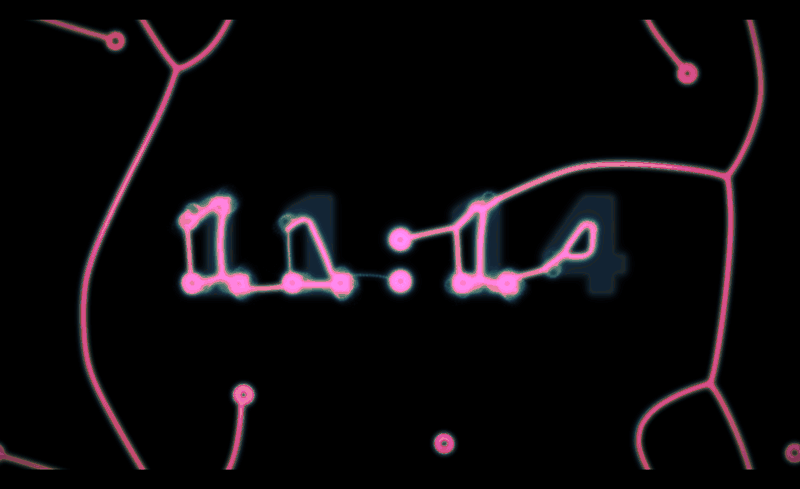

A GPU simulation of *Physarum polycephalum*, the slime mould, after Jeff Jones's agent model.
Each agent senses the trail ahead, ahead-left and ahead-right, turns towards the strongest scent,
moves and leaves its own trail, which spreads and fades; together they weave networks that
branch, merge and keep reorganising.

- **The clock** can be food the slime grows into, slime kept inside the digits, cut out of the
  network, or simply on top.
- **Eleven behaviours**, or expose the sensor angle, turn, distance, step, decay, diffusion and
  deposit directly.
- **Up to three species**, each following its own trail and avoiding the others, from 16 thousand
  to 8 million agents on a trail map up to 3840 × 2160.
- **Starts and food**, scatter food the network links like a rail map, and density, species,
  fire, neon, ink or plasma looks with relief / landscape / tunnel / globe views.

### Physarum Lite

The slime mould tuned for low-resource devices: no timers, no automatic restarts or behaviour
changes, just the agent passes and the draw pass, with an optional clock that is off by default.
The defaults are light (16 thousand agents, a 480 × 270 trail, no glow, no screen effect).

Both are 32-bit Android only.

---

## Physarum Visualisation

Physarum Lite as a **music visualisation**: the same GPU slime mould, with no clock and no
timers, driven by whatever Kodi is playing. An analyser measures the level, five bands, a beat
and a 32-band spectrum; loud passages make the agents travel further, bass thickens the trails, a
beat jolts the agents and sends a ring across the screen, and the palette drifts with the music.
One Reactivity slider sets how much the music does, and each reaction can be switched off on its
own.

Pick it under **Settings → Player → Music → Visualisation** (or from the music OSD) while a song
plays. There are two Kodi add-ons, one for macOS and 64-bit Android and one for 32-bit Android.

---

## Licence

The add-on code is MIT-licensed. Bundled data and imagery keep their own licences, listed
above and in each add-on's `LICENSE.txt` or `addon.xml`. The OpenTrivia questions and answers
are © the OpenTriviaQA contributors and licensed CC BY-SA 4.0.

Ship positions come from aisstream.io (a free API key is required); the map is the EOX
Sentinel-2 cloudless 2025 mosaic (Contains modified Copernicus Sentinel data 2025), used
non-commercially under CC BY-NC-SA 4.0 with credit shown on screen; ship details come from
Wikidata (CC0) and photographs are loaded from Wikimedia Commons, each under its own licence. No
photographs, map image or API key are bundled with the Ship Tracker add-on.

All data comes from public sources. It is for personal use, so follow each provider's
terms. Positions of flights, satellites and events are as accurate as the feeds they come
from.
